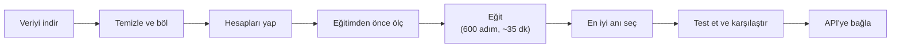
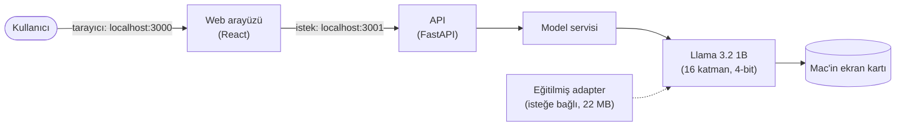

# Private AI Studio

Şirket verisini dışarıya göndermeden, şirketin kendi bilgisayarında çalışan ve şirket verisiyle eğitilebilen bir yapay zekâ sistemi.

| | |
|---|---|
| **Danışman** | Cem Ünsalan |
| **Test edilen bilgisayar** | MacBook Air M3, 16 GB bellek, macOS 26.5 |
| **Kullanılan model** | Llama 3.2 1B Instruct (4-bit) |
| **Son güncelleme** | 25 Kasım 2026 |

---

## İçindekiler

1. [Proje ne yapıyor?](#1-proje-ne-yapıyor)
2. [Kurulum](#2-kurulum)
3. [Uygulamayı kullanma](#3-uygulamayı-kullanma)
4. [Hangi modeli seçtik ve neden?](#4-hangi-modeli-seçtik-ve-neden)
5. [Modeli nasıl eğittik?](#5-modeli-nasıl-eğittik)
6. [Sonuçlar](#6-sonuçlar)
7. [Sistem nasıl çalışıyor?](#7-sistem-nasıl-çalışıyor)
8. [Eğitimi baştan çalıştırma](#8-eğitimi-baştan-çalıştırma)
9. [Sık karşılaşılan sorunlar](#9-sık-karşılaşılan-sorunlar)
10. [Güvenlik ve internetsiz çalışma](#10-güvenlik-ve-internetsiz-çalışma)
11. [Yol haritası](#11-yol-haritası)
12. [Kavramlar sözlüğü](#12-kavramlar-sözlüğü)
13. [Ayrıntılı dokümanlar](#13-ayrıntılı-dokümanlar)
14. [Proje klasörleri](#14-proje-klasörleri)
15. [Kaynaklar](#15-kaynaklar)

---

## 1. Proje ne yapıyor?

Şirketler yapay zekâ modellerini çoğunlukla bulut servisleri üzerinden kullanıyor. Bu durumda yazılan her soru ve yüklenen her doküman başka bir şirketin sunucusuna gidiyor. Sözleşmeler, müşteri bilgileri ya da kaynak kod gibi gizli veriler için bu ciddi bir risk.

Bu projede bir yapay zekâ modelini tamamen kendi bilgisayarımızda çalıştırıyor ve kendi verimizle eğitiyoruz. Kurulum bittikten sonra internete ihtiyaç kalmıyor.

### Şimdiye kadar yaptıklarımız

1. Meta'nın açık kaynaklı dil modeli **Llama 3.2 1B**'yi bilgisayarımızda çalıştırdık.
2. Modelle konuşmak için bir web arayüzü ve bir API yazdık.
3. Hocamızın önerdiği referans projeyi (MoAshour93/MLX_Finetuning) satır satır inceledik. Eğitmenin hangi ayarları neden seçtiğini analiz ettik, hesaplarındaki hataları ve tutarsızlıkları not ettik.
4. Referans projedeki eğitim sürecini kendi modelimize uyguladık. Referans projenin verisi paylaşılmadığı için yerine aynı yapıda bir Türkçe hukuk soru-cevap verisi kullandık.
5. Modeli eğitimden önce ve sonra ölçüp karşılaştırdık.
6. Modelin dokümanlardan bilgi bularak cevap vermesini sağlayan basit bir arama sistemi (RAG) kurduk.
7. Eğitilmiş modeli API'ye bağladık. Tek bir ayarla eğitilmiş model ya da orijinal model seçilebiliyor.

**En önemli sonuç:** Eğitimden sonra modelin test sorularındaki kararsızlığını gösteren değer (perplexity) **27,6'dan 7,1'e** indi. En iyi cevapları, eğitilmiş modeli doküman aramasıyla birlikte kullandığımızda aldık.

### Projenin şu anki durumu

| Bölüm | Durum |
|---|---|
| Modelin internetsiz çalışması | ✅ Wi-Fi kapalıyken denendi |
| Web arayüzü ve API | ✅ Çalışıyor |
| Tek komutla kurulum ve başlatma | ✅ `setup.sh` ve `start.sh` |
| Eğitim verisinin hazırlanması | ✅ Çalışıyor |
| Modelin LoRA yöntemiyle eğitilmesi | ✅ İlk deney bitti |
| Ölçme ve karşılaştırma | ✅ Çalışıyor |
| Eğitilmiş modelin API'ye bağlanması | ✅ Çalışıyor |
| Doküman arama (RAG) | 🟡 Basit bir ilk sürüm hazır |
| Farklı ayarlarla karşılaştırmalı eğitimler | 🔄 Sürüyor |
| Kullanıcı girişi ve sohbet geçmişi | ❌ Henüz yok |

---

## 2. Kurulum

Bu bölüm, projeyi daha önce hiçbir şey kurulmamış bir Mac'e kurmak için hazırlandı. Kurulumu iki yoldan yapabilirsiniz:

- **Kısa yol:** Tek bir komutla her şeyi otomatik kurmak ([2.3](#23-kısa-yol-tek-komutla-kurulum)).
- **Adım adım kurulum:** Her adımı ne işe yaradığını görerek elle yapmak ([2.4](#24-adım-adım-kurulum)).

İki yolun sonucu aynıdır.

### 2.1 Neler gerekiyor?

| Gereksinim | Açıklama |
|---|---|
| **Apple Silicon işlemcili bir Mac** (M1, M2, M3 veya M4) | Projede kullandığımız MLX kütüphanesi yalnızca Apple'ın kendi işlemcilerinde çalışıyor. Intel işlemcili Mac'lerde, Windows'ta ve Linux'ta çalışmaz. Mac'inizin işlemcisini sol üstteki Apple menüsünden **Bu Mac Hakkında** penceresinde görebilirsiniz. |
| **Bellek** | Model çalışırken yaklaşık 1 GB, eğitim sırasında yaklaşık 2 GB bellek kullanıyor. Biz 16 GB bellekli bir Mac'te denedik. 8 GB'lık bir Mac'te denemedik. |
| **Boş disk alanı** | Yaklaşık 3 GB. Model 0,7 GB, Python paketleri 0,7 GB, eğitim çıktıları 1 GB kadar yer tutuyor. |
| **İnternet bağlantısı** | Yalnızca kurulum sırasında gerekiyor. Program paketleri ve model bir kez indiriliyor. |
| **Hugging Face hesabı** | Gerekmiyor. Kullandığımız model ve veri herkese açık. |

Kurulum yaklaşık 15 dakika sürüyor; sürenin çoğu dosya indirmekle geçiyor.

### 2.2 Projeyi bilgisayara almak

Proje GitHub'da herkese açık olarak duruyor: <https://github.com/ErennSaglam/private-ai-studio>

Projeyi indirmek için **Terminal** uygulamasını açın. Terminal, Mac'e yazılı komut vermeye yarayan programdır; Finder'da **Uygulamalar → İzlenceler → Terminal** yolunda bulunur.

Projeyi hangi klasöre indirmek istiyorsanız oraya geçin. Örneğin masaüstüne indirmek için:

```bash
cd ~/Desktop
```

Projeyi GitHub'dan indirin. **git**, kod projelerini indirmeye ve sürümlerini takip etmeye yarayan bir araçtır ve macOS'ta hazır bulunur. Bilgisayarınız git'i ilk kez kullanıyorsa "komut satırı geliştirici araçlarını yüklemek ister misiniz?" diye sorabilir; **Yükle** deyip kurulumun bitmesini bekleyin, sonra komutu tekrar çalıştırın.

```bash
git clone https://github.com/ErennSaglam/private-ai-studio.git
```

İndirilen proje, hukuk verisiyle eğitilmiş adapter dosyasını da (`adapters/law-qa-r8-best`, 22 MB) içerir. Böylece eğitim yapmadan eğitilmiş modeli deneyebilirsiniz. Model dosyaları ise boyutları büyük olduğu için GitHub'da tutulmaz; kurulum sırasında indirilir.

Proje klasörüne girin:

```bash
cd private-ai-studio
```

Bu noktadan sonraki bütün komutlar **proje klasörünün içinden** çalıştırılır.

### 2.3 Kısa yol: tek komutla kurulum

Proje klasöründe şu komutu çalıştırın:

```bash
./setup.sh
```

`setup.sh` dosyası sırasıyla şunları yapar:

1. Bilgisayarın Apple Silicon işlemcili bir Mac olduğunu ve yeterli disk alanı bulunduğunu kontrol eder.
2. Homebrew'un kurulu olup olmadığına bakar.
3. Python 3.12 ve Node.js kurulu değilse kurar.
4. Projeye özel Python ortamını oluşturur ve gerekli Python paketlerini yükler.
5. Modeli indirir (yalnızca ilk çalıştırmada).
6. Web arayüzünün paketlerini yükler.
7. Modeli internetsiz modda kısa bir soruyla dener.

Her adımın sonunda yeşil bir ✓ işareti görünür. Bir sorun çıkarsa kırmızı ✗ işaretiyle birlikte ne yapılması gerektiği yazılır. Komutu birden fazla kez çalıştırmak sorun yaratmaz; daha önce kurulmuş olanları atlar.

Homebrew kurulu değilse script durur ve Homebrew'un nasıl kurulacağını gösterir. Homebrew'u kurduktan sonra `./setup.sh` komutunu tekrar çalıştırın.

Kurulum bitince [Bölüm 3](#3-uygulamayı-kullanma)'e geçebilirsiniz.

### 2.4 Adım adım kurulum

Bu yol, `setup.sh` dosyasının yaptıklarını tek tek elle yapmak isteyenler içindir.

#### Adım 1: Homebrew

**Homebrew**, Mac'e program kurmayı kolaylaştıran bir araçtır. Python ve Node.js'i bununla kuracağız. Kurulu olup olmadığını öğrenmek için:

```bash
brew --version
```

Ekranda bir sürüm numarası görüyorsanız sonraki adıma geçin. `command not found` hatası alıyorsanız Homebrew'u kurun:

```bash
/bin/bash -c "$(curl -fsSL https://raw.githubusercontent.com/Homebrew/install/HEAD/install.sh)"
```

Kurulum sizden Mac'inizin şifresini isteyebilir. Kurulum bittiğinde ekranda **Next steps** başlığı altında iki komut gösterilir. Bu komutlar Homebrew'u Terminal'e tanıtır; ikisini de kopyalayıp çalıştırın.

#### Adım 2: Python 3.12 ve Node.js

**Python**, modeli çalıştıran ve eğiten programların yazıldığı dildir. Mac'le birlikte gelen Python sürümü (3.9) bu proje için eski kalıyor; kullandığımız kütüphaneler en az 3.11 sürümünü istiyor.

**Node.js**, web arayüzünü çalıştırmak için gerekiyor.

İkisini birlikte kurun:

```bash
brew install python@3.12 node
```

Kurulduklarını kontrol edin. İlk komut `Python 3.12.x`, ikinci komut `v20` veya daha yeni bir sürüm göstermeli:

```bash
python3.12 --version
```

```bash
node --version
```

#### Adım 3: Projeye özel Python ortamı

Python paketlerini doğrudan bilgisayara kurmak yerine, yalnızca bu projeye ait bir **sanal ortam** oluşturuyoruz. Böylece bu projenin paketleri bilgisayardaki diğer projelerle karışmaz. Ortam, `backend/.venv` klasöründe oluşturulur:

```bash
python3.12 -m venv backend/.venv
```

Ortamı etkinleştirin. Bu komuttan sonra Terminal satırının başında `(.venv)` yazısı görünür:

```bash
source backend/.venv/bin/activate
```

> **Önemli:** Yeni bir Terminal penceresi açtığınızda ortam kapalı olur. Projeyle çalışmadan önce bu komutu her seferinde tekrar çalıştırın.

Python'un paket yükleme aracı **pip**'i güncelleyin:

```bash
pip install --upgrade pip
```

Uygulamanın ihtiyaç duyduğu paketleri yükleyin. Bunlar modeli çalıştıran **MLX-LM**, API'yi oluşturan **FastAPI** ve API'yi yayına alan **uvicorn**'dur:

```bash
pip install -r backend/requirements.txt
```

Eğitim araçlarının ihtiyaç duyduğu paketleri yükleyin (**pandas** ve **pyarrow**). Yalnızca modeli kullanacak, eğitmeyecekseniz bu adımı atlayabilirsiniz:

```bash
pip install -r training/requirements.txt
```

#### Adım 4: Modeli indirmek

Model dosyalarını **Hugging Face**'ten indiriyoruz. Hugging Face, yapay zekâ modellerinin ve veri setlerinin paylaşıldığı bir sitedir. Aşağıdaki komut yaklaşık 0,7 GB indirir ve dosyaları proje içindeki `models` klasörüne kaydeder:

```bash
hf download mlx-community/Llama-3.2-1B-Instruct-4bit --local-dir models/Llama-3.2-1B-Instruct-4bit
```

#### Adım 5: Web arayüzünün paketleri

Arayüz klasörüne geçin:

```bash
cd frontend
```

Arayüzün kullandığı paketleri yükleyin. **npm**, Node.js ile birlikte gelen paket yükleme aracıdır:

```bash
npm install
```

Proje klasörüne geri dönün:

```bash
cd ..
```

#### Adım 6: Kurulumu denemek

Modele, internet bağlantısı tamamen kapalıymış gibi bir soru sorun. Komutun başındaki `HF_HUB_OFFLINE=1` ayarı, programın internete çıkmasını yasaklar:

```bash
HF_HUB_OFFLINE=1 mlx_lm.generate --model models/Llama-3.2-1B-Instruct-4bit --prompt "Türkiye'nin başkenti neresidir? Tek kelimeyle cevap ver." --max-tokens 20 --temp 0
```

Ekranda modelin cevabı ve altında şuna benzer satırlar görünmeli:

```text
Ankara.
Prompt: 50 tokens, 58.530 tokens-per-sec
Generation: 4 tokens, 160.398 tokens-per-sec
Peak memory: 0.872 GB
```

Bir cevap geldiyse model tamamen sizin bilgisayarınızda çalışıyor demektir. Kurulum tamamlandı.

---

## 3. Uygulamayı kullanma

### 3.1 Uygulamayı başlatmak

Uygulama iki parçadan oluşur: modeli çalıştıran **API** ve tarayıcıda açılan **web arayüzü**. `start.sh` ikisini birlikte başlatır.

Orijinal modelle başlatmak için:

```bash
./start.sh
```

Hukuk verisiyle eğitilmiş modelle başlatmak için:

```bash
./start.sh law-qa-r8-best
```

Terminal'de `Arayüz başlatılıyor: http://localhost:3000` yazısını gördükten sonra tarayıcınızda **http://localhost:3000** adresini açın.

Uygulamayı kapatmak için Terminal'de **Ctrl + C** tuşlarına basın. API ve arayüz birlikte kapanır.

### 3.2 Eğitilmiş modeli denemek

1. Uygulamayı `./start.sh law-qa-r8-best` komutuyla başlatın. Arayüzün sol üstünde `+ LoRA: law-qa-r8-best` yazısı, eğitilmiş modelin kullanıldığını gösterir.
2. Sağ üstteki **Ayarlar** düğmesine tıklayın.
3. **Sistem mesajı** kutusuna modelin eğitimde gördüğü metni yazın:
   > Sen Türk hukuku konusunda uzman bir asistansın. Soruları Türk mevzuatına ve yargı kararlarına dayanarak kısa, açık ve Türkçe cevapla.
4. Bir hukuk sorusu sorun, örneğin: *Tutuklama sebepleri nelerdir?*

Her cevabın altında kaç kelime parçası üretildiği, saniyede kaç parça üretildiği ve ne kadar bellek kullanıldığı yazar.

### 3.3 İki parçayı ayrı ayrı başlatmak

`start.sh` kullanmak istemezseniz iki ayrı Terminal penceresi açın.

Birinci pencerede API'yi başlatın:

```bash
cd backend
```

```bash
source .venv/bin/activate
```

```bash
HF_HUB_OFFLINE=1 uvicorn app.main:app --host 127.0.0.1 --port 3001
```

Eğitilmiş modeli kullanmak için son komutun yerine şunu çalıştırın:

```bash
ADAPTER=law-qa-r8-best HF_HUB_OFFLINE=1 uvicorn app.main:app --host 127.0.0.1 --port 3001
```

Ekranda `Application startup complete.` yazısı görününce API hazırdır.

İkinci pencerede arayüzü başlatın:

```bash
cd frontend
```

```bash
npm run dev
```

### 3.4 API'yi doğrudan kullanmak

API çalışırken tarayıcıda **http://localhost:3001/docs** adresini açarsanız bütün uç noktaları görebilir ve deneyebilirsiniz.

| Adres | Ne işe yarar? |
|---|---|
| `GET /api/health` | Sistemin çalışıp çalışmadığını söyler |
| `GET /api/model-info` | Modelin katman sayısını, boyutlarını ve kullanılan adapter'ı gösterir |
| `POST /api/chat` | Modele soru gönderir; cevabı, hız ve bellek bilgisiyle birlikte döndürür |

---

## 4. Hangi modeli seçtik ve neden?

### 4.1 Seçtiğimiz model

**Llama 3.2 1B Instruct**, Meta'nın herkesin indirip kullanabileceği şekilde yayınladığı bir dil modelidir. Adındaki **1B** yaklaşık 1 milyar parametresi olduğunu, **Instruct** ise soru-cevap ve sohbet için ayrıca eğitildiğini belirtir.

Modelin **4-bit** sürümünü kullanıyoruz. Bu sürümde modelin içindeki sayılar daha az yer kaplayacak şekilde sıkıştırılmıştır. Böylece model 2,5 GB yerine **0,7 GB** yer tutar.

### 4.2 Modelin yapısı

Bu değerler modelin ayar dosyasından (`config.json`) okundu. Aynı bilgileri `python backend/scripts/inspect_model.py` komutuyla da görebilirsiniz.

| Özellik | Değer | Açıklama |
|---|---|---|
| Parametre sayısı | 1,24 milyar | Modelin eğitim sırasında öğrendiği sayıların toplamı |
| **Katman sayısı** | **16** | Model bir cevap üretirken metni art arda 16 katmandan geçirir |
| Bir katmanın içi | Attention ve MLP | Attention, kelimelerin birbiriyle ilişkisini kurar. MLP, bu bilgiyi işler. |
| Gizli boyut | 2048 | Model her kelime parçasını 2048 sayıdan oluşan bir dizi olarak tutar |
| Attention head sayısı | 32 | Her katman metne aynı anda 32 farklı açıdan bakar |
| Kelime hazinesi | 128 256 parça | Modelin tanıdığı farklı kelime parçası (token) sayısı |
| En uzun metin | 131 072 token | Modelin teorik olarak işleyebileceği en uzun metin |
| Dosya boyutu | 0,7 GB | 4-bit sıkıştırma sayesinde |

### 4.3 Neden bu modeli seçtik?

**Bilgisayarımıza sığıyor.** Referans projede kullanılan Mistral 7B modeli, eğitim sırasında 20 GB bellek kullanmış. Bizim bilgisayarımızda 16 GB bellek var. Llama 3.2 1B ise eğitim sırasında yalnızca **2 GB** bellek kullandı.

**Hızlı.** Model saniyede yaklaşık 160 kelime parçası üretiyor. Bir eğitim yaklaşık 35 dakikada bitiyor; bu da kısa sürede çok sayıda deneme yapmamızı sağlıyor.

**Yöntemi önce küçük modelde oturtmak istedik.** Bütün süreci küçük modelde kurup doğruladık. Aynı süreci daha büyük bir modelle (örneğin Llama 3.2 3B) çalıştırmak için ayar dosyasında tek bir satırı değiştirmek yetiyor.

**Lisansı ticari kullanıma izin veriyor.** Yalnızca aylık 700 milyondan fazla kullanıcısı olan şirketler için Meta'dan ayrıca izin almak gerekiyor.

### 4.4 İncelediğimiz diğer modeller

| Model | Parametre | Katman | Disk (4-bit) | Lisans | Değerlendirme |
|---|---|---|---|---|---|
| **Llama 3.2 1B** | 1,24 milyar | 16 | 0,70 GB | Llama 3.2 | **Seçildi** |
| Llama 3.2 3B | 3,21 milyar | 28 | 1,81 GB | Llama 3.2 | Sıradaki aday |
| Llama 3.1 8B | 8,03 milyar | 32 | 4,52 GB | Llama 3.1 | Eğitim için bellek sınırda |
| Mistral 7B v0.3 | 7,25 milyar | 32 | 4,08 GB | Apache 2.0 | Referans projenin modeli |
| Qwen2.5 1.5B | 1,54 milyar | 28 | 0,87 GB | Apache 2.0 | |
| Qwen2.5 3B | 3,09 milyar | 36 | 1,74 GB | Ticari kullanımı kısıtlı | Önerilmez |
| Qwen3 4B | 4,0 milyar | 36 | 2,26 GB | Apache 2.0 | Türkçe için iyi bir alternatif olabilir |

**Türkçe hakkında:** Llama'nın resmî olarak desteklediği diller arasında Türkçe yok. Model Türkçe anlıyor ve yazıyor, ama İngilizcedeki kadar iyi değil. Yaptığımız ölçümde aynı anlamdaki bir cümle Türkçede İngilizceye göre yaklaşık iki kat fazla parçaya bölündü. Örneğin "İstihkak" kelimesini model 5 parçada okuyor.

Ayrıntılı karşılaştırma: [docs/09-model-selection.md](docs/09-model-selection.md)

---

## 5. Modeli nasıl eğittik?

### 5.1 Kullandığımız yöntem: LoRA

Bir dil modelini sıfırdan eğitmek binlerce ekran kartı ve aylar gerektirir. Biz bunun yerine hazır bir modeli **kendi verimizle bir süre daha eğittik**. Bu işleme **fine-tuning** denir.

Fine-tuning sırasında modelin 1,24 milyar parametresinin hepsini değiştirmek hem çok bellek ister hem de modelin daha önce öğrendiklerini bozabilir. Bu yüzden **LoRA** yöntemini kullandık:

- Modelin orijinal parametrelerine dokunulmaz; olduğu gibi kalırlar.
- Her katmanın yanına küçük ek matrisler yerleştirilir ve eğitimde yalnızca bunlar öğrenilir.
- Eğitimin sonunda **22 MB'lık bir adapter dosyası** çıkar. Bu dosya modele takıldığında model eğitilmiş gibi davranır, çıkarıldığında orijinal haline döner.

Bunu bir formülle şöyle gösterebiliriz: **yeni ağırlık = orijinal ağırlık + ölçek × (B × A)**. Buradaki A ve B, eğitilen küçük matrislerdir.

### 5.2 Kaç katmanı eğittik?

| | Referans proje (Mistral 7B) | Bizim proje (Llama 1B) |
|---|---|---|
| Modelin toplam katman sayısı | 32 | 16 |
| LoRA eklenen katman sayısı | 16 (son yarısı) | **16 (hepsi)** |
| Her katmanda LoRA eklenen kısım | Yalnızca attention | Attention ve MLP (7 matris) |
| Rank (ek matrislerin boyutu) | 8 | 8 |
| Eğitilen parametre sayısı | 3,4 milyon (tümünün %0,047'si) | **5,6 milyon (tümünün %0,456'sı)** |

**Bir örnekle:** Katmanlardaki matrislerden biri 2048 × 2048 boyutundadır ve yaklaşık 4,2 milyon sayı içerir. LoRA bu matris için yalnızca 8 × (2048 + 2048) = **32 768** sayı öğrenir; bu, matrisin %0,78'ine denk gelir. Modelin tamamında eğitilen parametre sayısı 5 636 096'dır. Bu sayıyı hem elle hesapladık hem de programla ölçtük; iki sonuç da aynı çıktı.

### 5.3 Eğitim verisi

Referans proje, İngiltere'de inşaat ve gayrimenkul uzmanlarının girdiği bir meslek sınavının (RICS APC) soru-cevaplarıyla eğitilmiş. Bu veri paylaşılmadığı için aynı yapıda, ücretsiz ve açık lisanslı bir Türkçe veri seti seçtik:

| | |
|---|---|
| Veri seti | Türkçe Hukuk Soru-Cevap (`OrionCAF/turkish_law_qa_dataset`) |
| Lisans | Apache 2.0; ticari kullanıma da açık |
| İçerik | Türk hukukuyla ilgili 18 305 soru ve cevabı |
| Kullandığımız | 500 soru-cevap (referans projeyle aynı büyüklük) |

#### Veriyi nasıl hazırladık?

Veriyi eğitime vermeden önce `training/prepare_data.py` dosyasıyla beş işlem yaptık.

**Cevap olmayan satırları çıkardık.** Veride "Bu konuda daha fazla bilgi için şu yazıya bakabilirsiniz" gibi, soruyu cevaplamayıp okuru başka bir yere yönlendiren 194 satır vardı. Model böyle cevaplar vermeyi öğrenmesin diye bunları çıkardık.

**Tekrar eden soruları çıkardık.** Aynı soru 260 kez ikinci kez yer alıyordu. Her sorunun yalnızca ilk geçtiği yeri bıraktık.

**Veriyi üçe böldük.** 400 soruyu eğitim, 49 soruyu doğrulama, 50 soruyu test için ayırdık. Bu oran (%80, %10, %10) referans projedekiyle aynı. Eğitim setiyle model öğrenir, doğrulama setiyle eğitim sırasında ilerleme izlenir, test setiyle de en sonda başarı ölçülür.

**Bölerken aynı konudaki soruları ayırmadık.** Veride art arda gelen sorular aynı metinden üretilmiş. Ölçtüğümüzde, yan yana duran soruların rastgele seçilmiş sorulara göre altı kat daha benzer olduğunu gördük. Soruları rastgele dağıtsaydık, bir test sorusunun neredeyse aynısı eğitim setinde kalırdı ve model cevabı ezberden verirdi. Bunu önlemek için soruları 10'arlı konu grupları halinde böldük. Böylece test soruları, modelin eğitimde hiç görmediği konulardan geldi.

**Çok benzeyen soruları ayıkladık.** Doğrulama setindeki bir soru, eğitim setindeki başka bir soruya %84 oranında benziyordu. Ölçümü yanıltmasın diye bu soruyu doğrulama setinden çıkardık.

### 5.4 Eğitim ayarları

Bütün ayarlar, her satırının yanında açıklamasıyla birlikte [training/configs/law-qa-lora.yaml](training/configs/law-qa-lora.yaml) dosyasında duruyor. En önemlileri ve neden bu değerleri seçtiğimiz:

**Batch size: 4.** Model her adımda 4 soru-cevap görüyor. Bu, kullandığımız kütüphanenin varsayılan değeri. 400 soru 4'e tam bölündüğü için hiçbir soru dışarıda kalmıyor.

**Adım sayısı: 600.** 400 soruyu 4'erli gruplar halinde bir kez görmek 100 adım sürüyor. Verinin bir kez tamamen görülmesine **epoch** deniyor; yani 600 adım 6 epoch'a denk geliyor. Referans projenin eğitmeni 5 ile 8 epoch arasını önermişti. Biz 6'yı seçtik ve modelin ne zaman ezberlemeye başladığını görmek için eğitimi her 50 adımda bir ölçtük.

**Öğrenme hızı: 0,00001.** Modelin her adımda ne kadar değişeceğini belirler. Bu da kütüphanenin varsayılan değeri; referans projenin ölçülen eğitiminde de bu değer kullanılmış.

**Yalnızca cevaplardan öğrenme: açık.** Model sorunun kendisini değil, cevap vermeyi öğreniyor. Referans projenin kullandığı kütüphane sürümünde bu seçenek henüz yoktu.

**Her 50 adımda ölçüm ve kayıt.** Eğitim boyunca modelin ara hallerini kaydettik. Böylece en iyi sonucu veren anı sonradan seçebildik.

**Rastgelelik tohumu (seed): 42.** Aynı ayarlarla eğitimi tekrar çalıştırınca aynı sonucu almayı sağlıyor. Denedik ve sonuçlar birebir aynı çıktı.

Eğitime başlamadan önce bütün hesapları yapan küçük bir araç yazdık. `python training/plan.py training/configs/law-qa-lora.yaml` komutu adım sayısını, epoch'u, eğitilecek parametre sayısını ve yaklaşık bellek ihtiyacını gösterir.

### 5.5 Eğitimin aşamaları



**Referans projeden en önemli farkımız:** Referans proje, eğitimin son adımındaki modeli kullanıyordu. Biz eğitim boyunca modeli her 50 adımda ölçtük ve **en iyi sonucu verdiği anı** seçtik. Sonuçlar bu farkın ne kadar önemli olduğunu gösteriyor.

---

## 6. Sonuçlar

Bu bölümdeki bütün sayılar bizim bilgisayarımızda ölçüldü.

### 6.1 Eğitim sırasında neler oldu?

**Loss**, modelin hata miktarını gösterir; ne kadar düşükse o kadar iyidir. Aşağıdaki tabloda iki tür hata var: **eğitim hatası** modelin öğrendiği sorulardaki, **doğrulama hatası** ise modelin hiç görmediği sorulardaki hatadır.

| Adım | Epoch | Eğitim hatası | Doğrulama hatası |
|---|---|---|---|
| 1 | 0 | — | 3,21 |
| **100** | **1** | 1,93 | **1,99 ← en iyi an** |
| 300 | 3 | 0,95 | 2,13 |
| 600 | 6 | 0,29 | 2,74 |

Model en iyi haline birinci epoch'un sonunda ulaştı. Sonrasında öğrendiği sorulardaki hatası azalmaya devam etti, ama görmediği sorulardaki hatası arttı. Bu, modelin **ezberlemeye** başladığını gösterir; bu duruma İngilizcede **overfitting** denir. Bu yüzden 100. adımdaki modeli seçtik.

### 6.2 Test sonuçları

| Model | Test hatası | Perplexity |
|---|---|---|
| Eğitilmemiş model | 3,32 | 27,6 |
| Eğitilmiş model, son adım | 2,72 | 15,1 |
| **Eğitilmiş model, en iyi an** | **1,96** | **7,1** |

**Perplexity**, modelin her kelimede ortalama kaç seçenek arasında kaldığını gösterir. Bu değerin 27,6'dan 7,1'e inmesi, modelin hukuk metinlerini artık çok daha isabetli tahmin ettiği anlamına gelir. Son adım yerine en iyi anı seçmek, bu değeri yarı yarıya düşürdü.

### 6.3 Cevapların kalitesi

Aynı 50 test sorusunu dört farklı yöntemle cevaplattık:

| Yöntem | Benzerlik puanı | Cevap uzunluğu | Durmadan uzayan cevap |
|---|---|---|---|
| Eğitilmemiş model | 0,15 | Doğru cevabın 5 katı | 50 sorudan 35'inde |
| Eğitilmemiş model + doküman arama | 0,26 | Doğru cevabın 2,3 katı | 50 sorudan 23'ünde |
| Eğitilmiş model | 0,42 | Doğru cevaba yakın | 50 sorudan 6'sında |
| **Eğitilmiş model + doküman arama** | **0,45** | **Doğru cevapla aynı** | **50 sorudan 2'sinde** |

**Benzerlik puanı**, modelin cevabının doğru cevapla ne kadar ortak kelime içerdiğini gösterir (0 ile 1 arası).

**Bir örnek:** "Adli para cezasının ödenmemesi durumunda ne olur?" sorusunun doğru cevabı "Bu ceza hapis cezasına dönüşür."

| Yöntem | Modelin cevabı |
|---|---|
| Eğitilmemiş model | "…(also known as "hukuki para cezası")… hukuki haklarını (paralar) hukuki haklarını (paralar)…" — İngilizce kelimeler karışıyor ve cümle tekrar ediyor |
| Eğitilmiş model | "Adli para cezasının ödenmemesi durumunda, ceza ceza cezası olarak kabul edilir ve ceza ceza ceza…" — cevabın kalıbı doğru, içeriği bozuk |
| **Eğitilmiş model + doküman arama** | "Adli para cezasının ödenmemesi durumunda, bu ceza … doğrudan hapis cezasına çevrilebilir." — **doğru** |

### 6.4 Bu sonuçlardan ne öğrendik?

**Eğitim, modele cevap vermenin biçimini öğretti.** Cevaplar artık kısa, hukuk diline uygun ve veri setindeki kalıba benziyor.

**Eğitim, modele yeni bilgi öğretmedi.** Model, eğitimde görmediği konularda hâlâ yanlış bilgi verebiliyor. Bu, LoRA yönteminin bilinen bir sınırı.

**Doküman arama doğru metni bulduğunda cevap da doğru oluyor.** Ancak şu anki basit arama yöntemi, cevabı içeren metni soruların yalnızca %14'ünde bulabiliyor. Daha iyi bir arama yöntemi sıradaki işimiz.

**En iyi sonucu ikisi birlikte verdi.** Eğitim cevabın biçimini, doküman arama ise bilgiyi sağlıyor. Projenin hedeflediği yapı da tam olarak bu.

**Eğitimin en iyi anını seçmek çok önemli.** Referans projede bu adım yoktu.

**Sınırlar:** Kullandığımız model küçük ve test seti 50 sorudan oluşuyor. Benzerlik puanı, cevabın doğru olup olmadığını değil, doğru cevaba ne kadar benzediğini ölçüyor. Cevapların doğruluğunu ayrıca bir insan değerlendirmesiyle ölçmeyi planlıyoruz.

Deneyin bütün ayrıntıları: [docs/10-law-qa-experiment.md](docs/10-law-qa-experiment.md)

---

## 7. Sistem nasıl çalışıyor?



Kullanıcı tarayıcıda bir soru yazar. Web arayüzü bu soruyu API'ye gönderir. API soruyu model servisine iletir, model cevabı Mac'in ekran kartında üretir ve cevap aynı yoldan geri döner.

| Parça | Dosya | Ne yapıyor? |
|---|---|---|
| Web arayüzü | [frontend/src/App.jsx](frontend/src/App.jsx) | Sohbet ekranı. Sistem mesajı, sıcaklık ve cevap uzunluğu buradan ayarlanır. |
| API | [backend/app/main.py](backend/app/main.py) | Arayüzden gelen istekleri karşılar. Modeli program açılırken bir kez yükler. |
| Model servisi | [backend/app/model_service.py](backend/app/model_service.py) | Modeli çalıştırır. Bütün model işlemleri tek bir iş parçacığında yapılır. |
| Ayarlar | [backend/app/config.py](backend/app/config.py) | Hangi modelin ve hangi adapter'ın kullanılacağını belirler. |

**Model işlemleri neden tek bir iş parçacığında yapılıyor?** Mac'in ekran kartıyla kurulan bağlantı, onu kuran iş parçacığına aittir. API ise gelen her isteği farklı bir iş parçacığında çalıştırabilir. İlk denemede bu yüzden `RuntimeError: There is no Stream(gpu, 1) in current thread.` hatasını aldık. Çözüm olarak bütün model işlemlerini tek bir sabit iş parçacığına taşıdık. Bu düzen, aynı anda gelen soruların sırayla cevaplanmasını da sağlıyor.

**İki parça arasındaki bağlantı:** Web arayüzü 3000 numaralı portta, API 3001 numaralı portta çalışır. Tarayıcılar güvenlik nedeniyle farklı portlar arasındaki istekleri engeller; API bu yüzden yalnızca `localhost:3000` adresinden gelen isteklere izin verecek şekilde ayarlandı.

---

## 8. Eğitimi baştan çalıştırma

Bu bölüm, yaptığımız eğitimi aynı sonuçlarla yeniden üretmek isteyenler içindir. Önce [kurulumun](#2-kurulum) tamamlanmış olması gerekir. Bütün komutlar proje klasöründe ve Python ortamı açıkken çalıştırılır.

Python ortamını açın:

```bash
source backend/.venv/bin/activate
```

**1. Veriyi indirin.** Bu adım internet ister ve yaklaşık 2 MB indirir:

```bash
mkdir -p data/raw/turkish_law_qa
```

```bash
curl -L -o data/raw/turkish_law_qa/train-00000-of-00001.parquet "https://huggingface.co/datasets/OrionCAF/turkish_law_qa_dataset/resolve/3d30ce39bfc24bc3cc6c2582cb5cfae1fbd20006/data/train-00000-of-00001.parquet"
```

Bundan sonraki adımlar internet gerektirmez. Programların internete çıkmasını kapatın:

```bash
export HF_HUB_OFFLINE=1
```

**2. Veriyi hazırlayın.** Temizleme, tekrarları ayıklama, konu gruplarıyla bölme ve eğitim formatına çevirme işlemlerini yapar. Sonuçlar `data/law-qa` klasörüne yazılır:

```bash
python training/prepare_data.py
```

**3. Eğitim hesaplarını görün.** Adım sayısını, epoch'u, eğitilecek parametre sayısını ve bellek ihtiyacını gösterir:

```bash
python training/plan.py training/configs/law-qa-lora.yaml
```

**4. Modeli eğitimden önce ölçün.** Bu ölçüm, eğitimin ne kadar fark yarattığını görmek için gereklidir. Sonuç `Test loss 3.318` civarında olmalı:

```bash
mlx_lm.lora --model models/Llama-3.2-1B-Instruct-4bit --data data/law-qa --test --test-batches -1 --batch-size 4 --mask-prompt --max-seq-length 512 --adapter-path ""
```

**5. Modeli eğitin.** Yaklaşık 35 dakika sürer. Ekrana yazılanlar aynı zamanda bir dosyaya kaydedilir:

```bash
mkdir -p training/results/law-qa
```

```bash
mlx_lm.lora -c training/configs/law-qa-lora.yaml 2>&1 | tee training/results/law-qa/train_control.log
```

**6. Doküman arama için veri tabanını oluşturun:**

```bash
python training/rag.py build
```

**7. En iyi anı seçin, test edin ve dört yöntemi karşılaştırın.** Yaklaşık 15 dakika sürer:

```bash
python training/run_experiments.py control
```

**8. Raporu oluşturun.** Rapor `training/results/law-qa/report.md` dosyasına yazılır:

```bash
python training/report.py
```

> **Uzun eğitimlerde dikkat:** Bilgisayar şarja takılı ve kapağı açık olmalı. Kapak kapanırsa Mac uykuya geçer ve eğitim durur. Uykuya geçmeyi engellemek için eğitim komutunun başına `caffeinate -i -s` ekleyebilirsiniz.

### Başka bir veriyle eğitmek

Aynı süreç başka bir veriyle de çalışır:

1. Veriyi **soru** ve **cevap** sütunlarından oluşan bir tablo haline getirin.
2. `training/prepare_data.py` dosyasında okunacak dosyanın yolunu ve sistem mesajını (`SYSTEM_PROMPT`) değiştirin.
3. `training/configs/law-qa-lora.yaml` dosyasının bir kopyasını oluşturun ve içindeki `data` ile `adapter_path` satırlarını yeni klasörlere göre düzenleyin.
4. `python training/plan.py` komutuyla yeni ayar dosyasının hesaplarını kontrol edin.
5. Yukarıdaki 4–8. adımları uygulayın.

---

## 9. Sık karşılaşılan sorunlar

| Karşılaşılan durum | Neden olur, ne yapılmalı? |
|---|---|
| `zsh: command not found: brew` | Homebrew kurulu değil ya da Terminal'e tanıtılmamış. [Adım 1](#adım-1-homebrew)'deki kurulumu ve sondaki iki komutu çalıştırın. |
| `No matching distribution found for mlx-lm` | Python ortamı eski bir Python sürümüyle oluşturulmuş. `rm -rf backend/.venv` komutuyla ortamı silin ve `./setup.sh` komutunu tekrar çalıştırın. |
| `command not found: mlx_lm.generate` veya `command not found: hf` | Python ortamı açık değil. `source backend/.venv/bin/activate` komutunu çalıştırın. |
| `3000 numaralı port kullanımda` | Başka bir program bu portu kullanıyor. Mesajdaki `lsof` komutuyla programı bulup kapatın. |
| `Address already in use` | API zaten çalışıyor olabilir. `lsof -nP -iTCP:3001 -sTCP:LISTEN` komutuyla kontrol edin. |
| Tarayıcıda `CORS policy` hatası | Arayüz 3000 dışında bir portta açılmış. Uygulamayı `./start.sh` ile başlatın. |
| `RuntimeError: There is no Stream(gpu, …) in current thread.` | Model servisindeki tek iş parçacığı düzeni bozulmuş. `backend/app/model_service.py` dosyasını orijinal haline getirin. |
| Eğitim çok yavaşladı ya da durdu | Mac uykuya geçmiş ya da ısınmış olabilir. Şarja takın ve kapağı açık tutun. |
| Kurulum Intel işlemcili bir Mac'te çalışmıyor | MLX yalnızca Apple Silicon işlemcilerde çalışır. |

---

## 10. Güvenlik ve internetsiz çalışma

| Konu | Durum |
|---|---|
| İnternet ihtiyacı | Kurulumdan sonra internet gerekmez. Wi-Fi kapalıyken denendi. |
| Dışarıya veri gönderimi | Yok. Web arayüzü yalnızca aynı bilgisayardaki API'yle konuşur. |
| Dışarıdan erişim | API yalnızca bu bilgisayardan erişilebilir (`127.0.0.1`). Aynı ağdaki başka cihazlar bağlanamaz. |
| Model dosyaları | `safetensors` biçiminde saklanır; bu biçim çalıştırılabilir kod içeremez. |
| Eğitim verisi | `data`, `adapters` ve `models` klasörleri Git'e eklenmeyecek şekilde ayarlandı (`.gitignore`). |
| Eksikler | API'de kullanıcı girişi yok. Bu yüzden API ağa açılmamalı. |

**Önemli:** Eğitilmiş adapter dosyası, eğitim verisindeki bilgilerin bir kısmını taşır. Gizli bir veriyle eğitim yapılırsa adapter dosyası da gizli kabul edilmelidir.

Ayrıntılar: [docs/08-security-and-offline-operation.md](docs/08-security-and-offline-operation.md)

---

## 11. Yol haritası

| # | Aşama | Durum |
|---|---|---|
| 1 | Modeli bilgisayarda çalıştırmak | ✅ Tamamlandı |
| 2 | Modelin yapısını incelemek | ✅ Tamamlandı |
| 3 | Modeli eğitimden önce ölçmek | ✅ Tamamlandı |
| 4 | Eğitim verisini hazırlamak | ✅ Tamamlandı |
| 5 | Modeli LoRA ile eğitmek | ✅ Tamamlandı |
| 6 | Eğitilmiş modeli API'ye bağlamak | ✅ Tamamlandı |
| 7 | Farklı ayarlarla karşılaştırmalı eğitimler | 🔄 Sürüyor |
| 8 | Kapsamlı değerlendirme (insan değerlendirmesi dahil) | 🟡 Kısmen |
| 9 | Doküman arama (RAG) | 🟡 Basit sürüm hazır |
| 10 | Kurumsal kullanım (kullanıcı girişi, yetkilendirme, kayıt tutma) | ⏳ Planlandı |

**Sıradaki işler:**
1. Karşılaştırmalı eğitimlerin sonuçlarını değerlendirmek.
2. Ezberlemeyi önlemek için modeli 1–2 epoch ile yeniden eğitmek.
3. Anlam tabanlı doküman arama eklemek ve cevaplarda kaynak göstermek.
4. Aynı deneyi daha büyük bir modelle (Llama 3.2 3B) tekrarlamak.
5. Cem Hoca'nın vereceği veriyle aynı süreci çalıştırmak.

---

## 12. Kavramlar sözlüğü

| Kavram | Anlamı |
|---|---|
| **Dil modeli (LLM)** | Çok büyük miktarda metinle eğitilmiş; metni anlayıp yeni metin üretebilen yapay zekâ modeli |
| **Llama** | Meta'nın herkesin indirip kullanabileceği şekilde yayınladığı dil modeli ailesi |
| **Parametre** | Modelin eğitim sırasında öğrendiği sayılar. Llama 3.2 1B'de 1,24 milyar tane var. |
| **Katman** | Modeli oluşturan, art arda çalışan yapı taşları. Her katman metni bir adım daha işler. Bizim modelimizde 16 katman var. |
| **Token** | Modelin metni okurken kullandığı kelime parçası. "Kiracı" kelimesi "Kir" ve "acı" olmak üzere iki parçaya bölünür. |
| **4-bit sıkıştırma (quantization)** | Modelin sayılarını daha az yer kaplayacak şekilde saklamak. Model 2,5 GB'tan 0,7 GB'a iner. |
| **Fine-tuning** | Hazır bir modeli kendi verimizle bir süre daha eğitmek |
| **LoRA** | Modelin orijinal parametrelerine dokunmadan, küçük ek matrislerle yapılan verimli fine-tuning yöntemi |
| **Adapter** | LoRA eğitiminin sonunda çıkan küçük dosya (22 MB). Modele takılıp çıkarılabilir. |
| **Rank** | LoRA ek matrislerinin boyutu. Büyüdükçe modelin öğrenebileceği şey artar. |
| **Epoch** | Eğitim verisinin bir kez baştan sona görülmesi. Bizde 100 adım bir epoch'a denk geliyor. |
| **Batch size** | Bir eğitim adımında birlikte işlenen örnek sayısı |
| **Öğrenme hızı (learning rate)** | Modelin her adımda ne kadar değişeceği |
| **Loss (hata)** | Modelin tahminlerindeki hata miktarı. Düşük olması iyidir. |
| **Perplexity** | Modelin her kelimede ortalama kaç seçenek arasında kaldığı. Düşük olması iyidir. |
| **Overfitting (ezberleme)** | Modelin eğitim verisini ezberleyip yeni sorularda kötüleşmesi |
| **Checkpoint** | Eğitimin belli bir anında kaydedilen model hali |
| **Eğitim, doğrulama ve test seti** | Eğitim setiyle model öğrenir. Doğrulama setiyle eğitim sırasında ilerleme izlenir. Test seti ise en sonda bir kez ölçülen, modelin hiç görmediği veridir. |
| **RAG (doküman arama)** | Soru geldiğinde ilgili dokümanları bulup modele kaynak olarak vermek. Modeli yeniden eğitmeden güncel bilgi sağlar. |
| **BM25** | Ortak kelimelere bakarak doküman bulan klasik bir arama yöntemi |
| **MLX ve MLX-LM** | Apple'ın, yapay zekâ modellerini Mac'in ekran kartında çalıştırmak ve eğitmek için geliştirdiği kütüphaneler |
| **API** | Programların birbiriyle konuşmasını sağlayan arayüz. Web arayüzümüz modelle API üzerinden konuşuyor. |
| **Port** | Bir bilgisayarda aynı anda çalışan programların birbirine karışmadan haberleşmesini sağlayan numaralı kapı. Arayüz 3000, API 3001 numaralı portu kullanıyor. |

---

## 13. Ayrıntılı dokümanlar

| Dosya | Konusu |
|---|---|
| **[SUNUM.md](SUNUM.md)** | **Projeyi anlatmak için hazırlanmış konuşma metni** |
| **[docs/10-law-qa-experiment.md](docs/10-law-qa-experiment.md)** | **Eğitim deneyinin bütün ayrıntıları** |
| [docs/07-reference-project-analysis.md](docs/07-reference-project-analysis.md) | Referans projenin incelemesi ve bulunan tutarsızlıklar |
| [docs/09-model-selection.md](docs/09-model-selection.md) | Modellerin karşılaştırması |
| [docs/03-fine-tuning-configuration.md](docs/03-fine-tuning-configuration.md) | Eğitim ayarlarının tek tek açıklaması |
| [docs/04-training-calculations.md](docs/04-training-calculations.md) | Eğitim hesapları: epoch, parametre, bellek, süre |
| [docs/01-mathematical-foundations.md](docs/01-mathematical-foundations.md) | Arka plandaki matematik, sayısal örneklerle |
| [docs/02-dataset-preparation.md](docs/02-dataset-preparation.md) | Veri hazırlama kuralları |
| [docs/05-evaluation.md](docs/05-evaluation.md) | Ölçme yöntemleri ve sınırları |
| [docs/06-experimental-design.md](docs/06-experimental-design.md) | Deney tasarımı |
| [docs/00-technologies.md](docs/00-technologies.md) | Kullanılan teknolojiler |
| [docs/08-security-and-offline-operation.md](docs/08-security-and-offline-operation.md) | Güvenlik |

**Bilgilerin kaynağı hakkında:** Referans projenin GitHub sayfasındaki bütün dosyaları inceledik. Referans videoyu izleyemedik; videoyla ilgili bilgiler ekibimizin aldığı notlara dayanıyor. Modellerin teknik özelliklerini resmî ayar dosyalarından okuduk. Kullandığımız MLX-LM sürümünün (0.32.2) kaynak kodunu doğrudan inceledik.

---

## 14. Proje klasörleri

```text
private-ai-studio/
├── README.md                     bu dosya
├── SUNUM.md                      projeyi anlatmak için konuşma metni
├── setup.sh                      tek komutla kurulum
├── start.sh                      API ve arayüzü birlikte başlatır
├── backend/                      API ve model servisi
│   ├── requirements.txt          Python paketleri
│   ├── app/
│   │   ├── main.py               API uç noktaları
│   │   ├── model_service.py      modeli çalıştıran servis
│   │   ├── schemas.py            istek ve cevapların yapısı
│   │   └── config.py             model ve adapter seçimi
│   └── scripts/
│       └── inspect_model.py      modelin yapısını gösterir
├── frontend/                     web arayüzü (React)
│   └── src/App.jsx
├── training/                     eğitim ve ölçme araçları
│   ├── prepare_data.py           veriyi temizler ve böler
│   ├── plan.py                   eğitim hesaplarını yapar
│   ├── configs/law-qa-lora.yaml  eğitim ayarları (açıklamalı)
│   ├── select_best.py            en iyi anı seçer
│   ├── evaluate.py               cevapları üretir ve puanlar
│   ├── rag.py                    doküman arama
│   ├── run_experiments.py        deneyleri sırayla çalıştırır
│   ├── report.py                 sonuç raporunu oluşturur
│   └── results/law-qa/           ölçüm sonuçları ve kayıtlar
├── models/                       indirilen model (Git'e eklenmez)
├── adapters/                     eğitilmiş adapter dosyaları
├── data/                         eğitim verisi (Git'e eklenmez)
└── docs/                         ayrıntılı dokümanlar
```

---

## 15. Kaynaklar

- Referans proje: <https://github.com/MoAshour93/MLX_Finetuning>
- Referans video: <https://www.youtube.com/watch?v=Tam_i5mkCiQ> (izlenemedi)
- MLX: <https://github.com/ml-explore/mlx>
- MLX-LM: <https://github.com/ml-explore/mlx-lm>
- Model: <https://huggingface.co/mlx-community/Llama-3.2-1B-Instruct-4bit>
- Veri seti: <https://huggingface.co/datasets/OrionCAF/turkish_law_qa_dataset> (Apache 2.0)
- Hu ve diğerleri, *LoRA: Low-Rank Adaptation of Large Language Models*, 2021. arXiv:2106.09685
- Lewis ve diğerleri, *Retrieval-Augmented Generation for Knowledge-Intensive NLP Tasks*, 2020. arXiv:2005.11401
- Vaswani ve diğerleri, *Attention Is All You Need*, 2017. arXiv:1706.03762
- Robertson ve Zaragoza, *The Probabilistic Relevance Framework: BM25 and Beyond*, 2009
