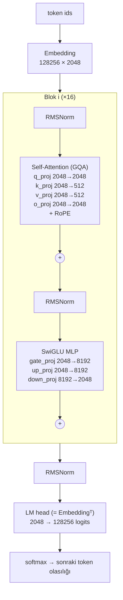

# 01 · Mathematical Foundations

[← README](../README.md)

Bu dosyadaki sayısal örnekler mümkün olduğunda **kurulu modelin gerçek boyutlarını** kullanır: Llama 3.2 1B, 16 katman, $d_{model}=2048$, 32 attention head, 8 KV head, $d_{head}=64$, MLP ara boyutu 8192, vocab 128 256.

Etiketler: **[Teori]** genel bilgi, **[Ölçüm]** bu projede ölçülen değer, **[Kod]** kurulu MLX-LM 0.32.2 kaynak kodundan doğrulanan davranış.

---

## 1. Tokenization

**[Teori]** Model metni değil, tam sayı dizilerini işler. Tokenizer metni **token** adı verilen parçalara böler ve her parçaya bir **token id** atar. Llama 3 ailesi **byte-level BPE** (Byte Pair Encoding) kullanır. BPE en sık geçen bayt çiftlerini tekrar tekrar birleştirerek bir kelime hazinesi (vocabulary) oluşturur.

$$\text{metin} \xrightarrow{\text{tokenizer}} [t_1, t_2, \dots, t_n], \quad t_i \in \{0, \dots, V-1\}, \quad V = 128\,256$$

**Neden önemli?**
- Bağlam uzunluğu (context length), hız ve bellek **token** cinsinden ölçülür, karakter cinsinden değil.
- Tokenizer bir dili iyi kapsamıyorsa, aynı cümle o dilde daha fazla token tutar. Bu durum maliyeti artırır ve etkin bağlamı kısaltır. Türkçe gibi eklemeli dillerde bu etki ölçülmelidir.

**Sayısal örnek:** Kendi testimizde aşağıdaki istek, chat template dahil **48 prompt token** tuttu **[Ölçüm]**:

```text
Türkiye'nin başkenti neresidir? Kısa cevap ver.
```

Bu sayının büyük kısmı template'in eklediği özel tokenlar ve sistem satırlarıdır ("Cutting Knowledge Date…", "Today Date…").

Ölçmek için:

```python
from mlx_lm import load
_, tok = load("models/Llama-3.2-1B-Instruct-4bit")
ids = tok.encode("Türkiye'nin başkenti neresidir?")
print(len(ids), [tok.decode([i]) for i in ids])
```

## 2. Embedding

**[Teori]** Embedding katmanı her token id'yi bir vektöre çevirir. Bu işlem bir tablo okumasıdır:

$$E \in \mathbb{R}^{V \times d}, \qquad x_i = E[t_i] \in \mathbb{R}^{d}$$

**Sayısal örnek (1B):**

$$V \cdot d = 128\,256 \times 2048 = 262\,668\,288 \approx 262.7\,\text{M parametre}$$

Bu, modelin toplam 1 235.8 M parametresinin **%21'i** eder **[Ölçüm: `get_total_parameters`]**. Llama 3.2 1B'de `tie_word_embeddings: true` ayarı vardır. Bu ayar, aynı $E$ matrisinin çıkışta logit hesabı için de kullanıldığını gösterir ($\text{logits} = h E^\top$).

`inspect_model.py` çıktısında bu tensör 4-bit paketli olarak görünür:

```text
model.embed_tokens.weight   (128256, 256)  uint32    # 2048 / 8 = 256 (her uint32 içinde 8 adet 4-bit değer)
model.embed_tokens.scales   (128256, 32)   float16   # 2048 / 64 = 32 grup
model.embed_tokens.biases   (128256, 32)   float16
```

## 3. Transformer

**[Teori]** Llama bir **decoder-only Transformer**'dır. 16 adet aynı yapıda blok (katman) art arda çalışır. Her blok iki alt bloktan oluşur ve her alt blok bir **residual** bağlantı ile sarılır:

$$h' = h + \text{Attention}(\text{RMSNorm}(h))$$
$$h'' = h' + \text{MLP}(\text{RMSNorm}(h'))$$



Llama'ya özgü bileşenler:
- **RMSNorm:** $\text{RMSNorm}(x) = \dfrac{x}{\sqrt{\frac{1}{d}\sum_j x_j^2 + \epsilon}} \odot g$. LayerNorm'dan farklı olarak ortalamayı çıkarmaz.
- **RoPE** (Rotary Position Embedding): Pozisyon bilgisini Q ve K vektörlerini döndürerek ekler. `rope_theta = 500000` değeri `config.json` içindedir.
- **SwiGLU MLP:** $\text{MLP}(x) = W_{down}\big(\text{SiLU}(W_{gate}x) \odot W_{up}x\big)$.
- **GQA** (Grouped-Query Attention): 32 query head 8 KV head'i paylaşır. Her KV head 4 query head'e hizmet eder. Bu yapı KV cache'i 4 kat küçültür.

## 4. Attention

**[Teori]** Her token, kendinden önceki tokenlara ne kadar "dikkat edeceğini" hesaplar:

$$\text{Attention}(Q,K,V) = \text{softmax}\!\left(\frac{QK^\top}{\sqrt{d_k}} + M\right)V$$

Burada $M$ **causal mask**'tir: gelecekteki pozisyonlar için $-\infty$ değeri alır. Bu sayede model ileriye bakamaz.

**Sayısal örnek** ($d_k = 2$, iki token):

$$q = [1, 0], \quad k_1 = [1, 0], \quad k_2 = [0, 1], \quad v_1 = [1, 2], \quad v_2 = [3, 4]$$

1. Skorlar: $q\cdot k_1/\sqrt{2} = 0.707$ ve $q\cdot k_2/\sqrt{2} = 0$.
2. Softmax: $e^{0.707} = 2.028$, $e^{0} = 1$. Toplam 3.028. Ağırlıklar $[0.670, 0.330]$.
3. Çıktı: $0.670\,[1,2] + 0.330\,[3,4] = [1.660, 2.660]$.

$q$, $k_1$ ile aynı yönde olduğu için $v_1$ daha çok ağırlık aldı.

**Neden $\sqrt{d_k}$ ile bölünür?** Bileşenleri birim varyanslı iki rastgele vektörün nokta çarpımının varyansı $d_k$'dir. Bölme işlemi olmasaydı skorlar büyür, softmax tek bir tokena kilitlenir ve gradyanlar söner. 1B modelde $d_k = d_{head} = 64$, yani bölen $\sqrt{64} = 8$.

## 5. Weight matrices

**[Teori]** Bir lineer katman $y = xW^\top$ (+ bias) işlemidir. Llama'da projeksiyonlarda bias yoktur. 1B modelde bir bloğun ağırlıkları:

| Modül | Şekil ($d_{out} \times d_{in}$) | Parametre |
|---|---|---|
| `self_attn.q_proj` | 2048 × 2048 | 4 194 304 |
| `self_attn.k_proj` | 512 × 2048 | 1 048 576 |
| `self_attn.v_proj` | 512 × 2048 | 1 048 576 |
| `self_attn.o_proj` | 2048 × 2048 | 4 194 304 |
| `mlp.gate_proj` | 8192 × 2048 | 16 777 216 |
| `mlp.up_proj` | 8192 × 2048 | 16 777 216 |
| `mlp.down_proj` | 2048 × 8192 | 16 777 216 |
| **Blok toplamı** | | **60 817 408** |

$16 \times 60.8\,\text{M} = 973.1\,\text{M}$. Buna embedding (262.7 M) ve normalizasyon vektörleri eklenince toplam yaklaşık 1 235.8 M olur. Normalizasyon vektörleri blok başına $2 \times 2048$, sonda bir kez 2048 parametredir. Toplam $1\,235\,814\,400$ eder ve `get_total_parameters` ile ölçülen 1 235.8144 M değeriyle birebir uyuşur **[Ölçüm]**. Parametrelerin yaklaşık **%65'i MLP**'de ($16 \times 50.3$ M), **%14'ü attention**'da ($16 \times 10.5$ M), **%21'i embedding**'dedir.

## 6. Forward propagation

**[Teori]** Forward pass, girdiden çıktıya kadar yapılan hesaplamadır:

$$t_{1..n} \to E \to \text{Blok}_1 \to \dots \to \text{Blok}_{16} \to \text{RMSNorm} \to \text{logits} \in \mathbb{R}^{n \times V}$$

Eğitimde $n$ pozisyonun hepsi için **paralel** olarak "bir sonraki token" tahmini üretilir. Üretimde (inference) ise her adımda tek bir yeni token için hesap yapılır. Önceki K ve V değerleri **KV cache**'ten okunur.

**[Kod]** MLX-LM eğitimde girdiyi ve hedefi bir pozisyon kaydırarak oluşturur (`tuner/trainer.py`, `default_loss`):

```python
inputs  = batch[:, :-1]
targets = batch[:, 1:]
logits  = model(inputs)
```

## 7. Softmax

**[Teori]** Logitleri olasılık dağılımına çevirir:

$$p_i = \frac{e^{z_i/T}}{\sum_j e^{z_j/T}}$$

$T$ **temperature** değeridir. $T \to 0$ olunca dağılım en yüksek logite yoğunlaşır (greedy seçim). $T$ büyüdükçe dağılım düzleşir.

**Sayısal örnek:** $z = [2.0, 1.0, 0.1]$

| | $T=1$ | $T=0.5$ |
|---|---|---|
| $e^{z/T}$ | 7.389, 2.718, 1.105 | 54.60, 7.389, 1.221 |
| $p$ | **0.659**, 0.242, 0.099 | **0.864**, 0.117, 0.019 |

Not: Temperature değeri 1 ile sınırlı değildir. API'miz 0–2 aralığına izin verir. Referans notebook'taki "Range is 0-1" yorumu bu açıdan eksiktir.

## 8. Cross-entropy loss

**[Teori]** Doğru sonraki token $y$ için modelin verdiği olasılığın negatif logaritması:

$$\mathcal{L} = -\frac{1}{N}\sum_{i=1}^{N}\log p_\theta(y_i \mid y_{<i})$$

**Sayısal örnek:** Yukarıdaki softmax'ta doğru token birinci token olsun. O zaman $p = 0.659$ ve $\mathcal{L} = -\ln 0.659 = 0.417$ olur.

**Referans noktaları:**
- Rastgele tahmin (uniform dağılım): $\ln V = \ln 128\,256 = 11.76$.
- Mükemmel tahmin: $0$.

**[Kod]** MLX-LM loss'u **token başına ortalama** olarak hesaplar ve padding ile maskelenen pozisyonları dışarıda bırakır:

```python
ce = nn.losses.cross_entropy(logits, targets) * mask
ce = ce.sum() / mask.sum()
```

`--mask-prompt` kapalıyken (varsayılan) maske tüm gerçek tokenları kapsar. Bu durumda sistem mesajı ve kullanıcı sorusu da loss'a girer. Ayrıntı: [02-dataset-preparation.md §8](02-dataset-preparation.md#8-assistant-only-loss-masking).

## 9. Perplexity

**[Teori]**

$$\mathrm{PPL} = e^{\mathcal{L}}$$

Sezgisel anlamı şudur: model her adımda ortalama olarak **kaç seçenek arasında kararsız kalıyor**.

| Loss | PPL | Yorum |
|---|---|---|
| 11.76 | 128 256 | Rastgele tahmin seviyesi |
| 3.945 | 51.68 | **[Referans]** MoAshour93 test sonucu |
| 2.0 | 7.39 | |
| 0.417 | 1.52 | Yukarıdaki örnek |

**[Kod]** `mlx_lm.lora --test` bu formülü doğrudan uygular: `test_ppl = math.exp(test_loss)`.

PPL'in sınırları: Aynı tokenizer ve aynı test seti olmadan karşılaştırılamaz. Doğruluk (factual correctness) ölçmez. Bkz. [05-evaluation.md](05-evaluation.md).

## 10. Backpropagation

**[Teori]** Zincir kuralı ile loss'un her parametreye göre türevi hesaplanır. Bu işlem çıkıştan girişe doğru, katman katman yapılır:

$$\frac{\partial \mathcal{L}}{\partial W_\ell} = \frac{\partial \mathcal{L}}{\partial h_\ell}\cdot\frac{\partial h_\ell}{\partial W_\ell}, \qquad \frac{\partial \mathcal{L}}{\partial h_{\ell-1}} = \frac{\partial \mathcal{L}}{\partial h_\ell}\cdot\frac{\partial h_\ell}{\partial h_{\ell-1}}$$

**Sayısal örnek** (tek nöron): $\hat y = wx$, $\mathcal{L} = (\hat y - y)^2$. Değerler $x=2$, $w=0.5$, $y=2$:

$$\hat y = 1, \quad \frac{\partial \mathcal{L}}{\partial \hat y} = 2(\hat y - y) = -2, \quad \frac{\partial \mathcal{L}}{\partial w} = -2 \cdot x = -4$$

**Bellek bağlantısı:** Backward pass için forward sırasında oluşan **activation** değerleri saklanmalıdır. Eğitim belleğinin büyük kısmı bu değerlerden gelir. `--grad-checkpoint` bu değerleri saklamak yerine yeniden hesaplar. Bkz. [04-training-calculations.md](04-training-calculations.md).

**LoRA'da:** Base ağırlıklar dondurulmuştur (`model.freeze()`), bu yüzden onlar için gradyan **saklanmaz**. Yine de gradyan, aktivasyonlar üzerinden tüm katmanlardan geriye akmak zorundadır. Bu nedenle LoRA eğitim belleği yalnızca "adapter boyutu" kadar değildir.

## 11. Gradient descent

**[Teori]**

$$\theta_{t+1} = \theta_t - \eta\,\nabla_\theta \mathcal{L}$$

**Sayısal örnek** (önceki örnekten devam): $w=0.5$, $\nabla = -4$, $\eta = 0.05$:

$$w_1 = 0.5 - 0.05 \cdot (-4) = 0.7$$

**Mini-batch SGD:** Gradyan, tüm veri yerine bir **batch** üzerinden hesaplanır. Bu bir tahmindir ve gürültülüdür. Batch büyüdükçe gürültü azalır, ama adım başına bellek ve süre artar.

## 12. Adam optimizer

**[Teori]** (Kingma & Ba, 2014) Adam her parametre için iki hareketli ortalama tutar:

$$m_t = \beta_1 m_{t-1} + (1-\beta_1)\,g_t, \qquad v_t = \beta_2 v_{t-1} + (1-\beta_2)\,g_t^2$$
$$\hat m_t = \frac{m_t}{1-\beta_1^t}, \quad \hat v_t = \frac{v_t}{1-\beta_2^t}, \qquad \theta_{t+1} = \theta_t - \eta\,\frac{\hat m_t}{\sqrt{\hat v_t}+\epsilon}$$

Varsayılanlar: $\beta_1 = 0.9$, $\beta_2 = 0.999$, $\epsilon = 10^{-8}$.

**Sayısal örnek** (ilk adım, $g_1 = 0.5$):

$$m_1 = 0.05, \quad v_1 = 0.00025, \quad \hat m_1 = 0.5, \quad \hat v_1 = 0.25, \quad \Delta\theta = -\eta \cdot \frac{0.5}{0.5} = -\eta$$

**Önemli sonuç:** Adam'da adım büyüklüğü gradyanın ölçeğinden büyük ölçüde bağımsızdır ve yaklaşık $\eta$ kadardır. `learning_rate = 1e-5` ayarı, her parametrenin her adımda **en fazla yaklaşık $10^{-5}$** kadar değiştiği anlamına gelir. Learning rate seçimi bu yüzden doğrudan "parametre ne kadar hızlı değişir" sorusudur.

**Bellek:** Adam, eğitilen her parametre için iki ek değer ($m$, $v$) tutar. LoRA'da yalnızca adapter parametreleri eğitildiği için bu maliyet küçüktür.

**[Kod]** MLX-LM'in varsayılan optimizer'ı `adam`. `--optimizer` ile `adamw`, `sgd`, `adafactor` veya `muon` seçilebilir.

## 13. LoRA matrix decomposition

**[Teori]** (Hu et al., 2021) Fine-tuning sırasında ağırlık değişimi $\Delta W$'nun **düşük rank**'lı olduğu varsayılır. $\Delta W$ tam bir matris olarak öğrenilmez, iki küçük matrisin çarpımı olarak öğrenilir:

$$W_{new} = W_{base} + s \cdot BA, \qquad B \in \mathbb{R}^{d_{out} \times r}, \quad A \in \mathbb{R}^{r \times d_{in}}, \quad r \ll \min(d_{in}, d_{out})$$

- $W_{base}$: dondurulmuş orijinal ağırlık. Bizim durumumuzda 4-bit quantized. Quantized base üzerinde LoRA yapmak **QLoRA** yaklaşımıdır.
- $A$, $B$: eğitilen adapter matrisleri.
- $r$: **rank**.
- $s$: **scaling** (ölçek).

**[Kod]** MLX-LM'deki gerçek uygulama (`tuner/lora.py`, `LoRALinear`):

```python
# başlangıç
self.lora_a = mx.random.uniform(low=-1/sqrt(d_in), high=1/sqrt(d_in), shape=(d_in, r))
self.lora_b = mx.zeros(shape=(r, d_out))
# forward
y = self.linear(x)                                  # x · W_baseᵀ (quantized)
z = (self.dropout(x) @ self.lora_a) @ self.lora_b   # x · A · B
return y + self.scale * z
```

Gözlemler:
1. $B$ **sıfırla** başlatılır. Bu yüzden eğitim başında $\Delta W = 0$ olur ve model base modelle **birebir aynı** davranır. Eğitim, base modelin davranışından başlar.
2. Forward sırasında $W_{base} + sBA$ matrisi hiç oluşturulmaz. Önce $x$ ile çarpılarak küçük $r$ boyutlu ara vektör hesaplanır. Bu işlem bellek ve hesap açısından ucuzdur.
3. `fuse` işlemi $W_{base} + s\cdot B^\top A^\top$ matrisini (MLX'in sakladığı transpoze düzende) bir kez hesaplar ve kalıcı yapar.

### Eğitilebilir parametre: full fine-tuning ve LoRA karşılaştırması

**Örnek matris:** 1B modelin `q_proj` katmanı, $d_{in} = d_{out} = 2048$:

| | Formül | Değer |
|---|---|---|
| Full fine-tuning | $d_{out} \cdot d_{in}$ | $2048 \times 2048 = 4\,194\,304$ |
| LoRA, $r = 8$ | $r(d_{in} + d_{out})$ | $8 \times 4096 = 32\,768$ |
| Oran | | **%0.78** |
| LoRA, $r = 16$ | | $65\,536$ (%1.56) |

**Tüm model (1B, $r = 8$, num_layers = 16, MLX-LM varsayılan hedef modülleri):**

| Modül | $d_{in} + d_{out}$ | $r(d_{in}+d_{out})$ |
|---|---|---|
| q_proj | 2048 + 2048 | 32 768 |
| k_proj | 2048 + 512 | 20 480 |
| v_proj | 2048 + 512 | 20 480 |
| o_proj | 2048 + 2048 | 32 768 |
| gate_proj | 2048 + 8192 | 81 920 |
| up_proj | 2048 + 8192 | 81 920 |
| down_proj | 8192 + 2048 | 81 920 |
| **Blok başına** | | **352 256** |
| **× 16 blok** | | **5 636 096 ≈ 5.64 M** |

$5.636\,\text{M} / 1235.8\,\text{M} = $ **%0.456**. Bu değer, kurulu MLX-LM ile `linear_to_lora_layers` uygulanıp eğitilebilir parametreler sayılarak doğrulandı **[Ölçüm]**:

| rank | num_layers | Ölçülen eğitilebilir parametre |
|---|---|---|
| 4 | 4 | 704 512 |
| 8 | 4 | 1 409 024 |
| 8 | 8 | 2 818 048 |
| 8 | 16 | 5 636 096 |
| 16 | 16 | 11 272 192 |

Parametre sayısı $r$ ve num_layers ile **doğrusal** büyür.

## 14. LoRA rank ve scaling

Üç farklı kavram sıkça karıştırılır:

| Kavram | Ne | 1B modelde |
|---|---|---|
| **Modelin toplam katman sayısı** | `config.json` → `num_hidden_layers` | 16 (sabit, mimarinin parçası) |
| **`num_layers`** (LoRA uygulanan blok sayısı) | **Son** kaç bloğa adapter ekleneceği. `-1` tümü demektir. | 1–16 arası seçilir. 16 = tümü. |
| **rank $r$** | Her adapter matrisinin iç boyutu | Genellikle 4–64 |

**[Kod]** MLX-LM adapter'ları **son** bloklara ekler: `for l in model.layers[-max(num_layers, 0):]`. `num_layers = 8` ayarı 1B modelde 8.–15. blokları (0 tabanlı) kapsar. İlk 8 blok değişmez.

**Scaling farkı (önemli):**
- Orijinal LoRA makalesi ve PEFT kütüphanesi: $s = \alpha / r$. Örneğin $\alpha = 16$, $r = 8$ için $s = 2$.
- **MLX-LM: $s$ doğrudan `scale` parametresidir. Varsayılanı 20'dir.** `alpha` anahtarı kullanılmaz. Config'e `alpha` yazılırsa 0.32.2 sürümü `KeyError` verir ve "use `scale`, not `alpha`" der **[Kod]**.
- Eşdeğerlik: MLX `scale = 20`, $r = 8$ için PEFT'teki $\alpha = s \cdot r = 160$ değerine karşılık gelir.

**Pratik sonuç:** Başka framework'lerdeki learning rate önerileri (örneğin LoRA için 1e-4–2e-4, $s = 2$ ile) MLX'e **doğrudan taşınmamalıdır**. $\Delta W = sBA$ olduğundan, $s$ değerini 10 kat büyütmek, adapter güncellemesinin çıktıya etkisini yaklaşık 10 kat büyütür. MLX-LM'in varsayılan learning rate değerinin (1e-5) düşük olmasının bir nedeni muhtemelen budur (bizim çıkarımımız).

**Rank'ın etkisi:** $r$ adapter'ın ifade kapasitesidir. Düşük $r$ değeri stil ve format gibi "dar" değişiklikler için çoğu zaman yeterlidir. Yeni ve geniş bilgi öğretmek için daha yüksek $r$ gerekebilir. Ancak LoRA ile yeni bilgi öğretmek sınırlıdır. Biderman et al. (2024) LoRA'nın full fine-tuning'e göre "daha az öğrendiğini ve daha az unuttuğunu" raporlar. Kurumsal bilgi için öncelikli yol RAG'dir.

## 15. Quantization

**[Teori]** Ağırlıkları daha az bitle saklamaktır. MLX'in **affine, grup bazlı** quantization yöntemi şu şekildedir: her $g$ ağırlıklık grup kendi `scale` ($\Delta$) ve `bias` ($\beta$) değerini taşır.

$$q = \text{round}\!\left(\frac{w - \beta}{\Delta}\right) \in \{0, \dots, 2^b - 1\}, \qquad \hat w = \Delta \cdot q + \beta$$

**Sayısal örnek** ($b = 4$, yani 16 seviye). Grupta en küçük değer $-0.12$, en büyük değer $0.18$ olsun:

$$\Delta = \frac{0.18 - (-0.12)}{15} = 0.02, \qquad \beta = -0.12$$

$w = 0.065$ için: $q = \text{round}(0.185 / 0.02) = \text{round}(9.25) = 9$ ve $\hat w = 0.02 \cdot 9 - 0.12 = 0.06$. Hata $0.005$.

**Kurulu modelde doğrulama** (`config.json`: `bits: 4`, `group_size: 64`):

$$\text{bit/ağırlık} = b + \frac{16 + 16}{g} = 4 + \frac{32}{64} = 4.5$$

Burada scale ve bias değerleri float16'dır, her biri 16 bit. Kontrol:

$$\frac{0.695 \times 10^9\ \text{bayt} \times 8}{1.2358 \times 10^9\ \text{parametre}} \approx 4.5\ \text{bit/parametre}$$

Hesap ölçülen dosya boyutuyla birebir uyuşuyor **[Ölçüm]**.

| Hassasiyet | bit/parametre | 1B ağırlık boyutu (teorik) |
|---|---|---|
| float32 | 32 | 4.94 GB |
| bfloat16 / float16 | 16 | 2.47 GB |
| 8-bit, g=64 | 8.5 | 1.31 GB |
| **4-bit, g=64** | **4.5** | **0.70 GB** (ölçülen: 0.695 GB) |

**Neden çalışır?** Ağırlıklar küçük gruplar içinde dar bir aralıktadır. LLM inference genellikle **bellek bant genişliği** ile sınırlıdır: her token için tüm ağırlıklar bellekten okunur. Daha az bit, daha az okuma ve daha hızlı üretim demektir.

**Bedeli:** Hassasiyet kaybı. Bu kayıp küçük modellerde ve düşük bit değerlerinde daha belirgin olabilir. Bizim için ölçülmesi gereken bir değişkendir (bkz. [06-experimental-design.md](06-experimental-design.md)).

**LoRA ile ilişkisi (QLoRA):** Base 4-bit kalır, adapter $A$ ve $B$ tam hassasiyette eğitilir. Dettmers et al. (2023) QLoRA'yı NF4 formatı ile tanımlar. MLX'in affine 4-bit formatı aynı **fikri** uygular, ancak aynı veri tipi değildir.

---

## Kaynaklar

- Vaswani et al., *Attention Is All You Need*, 2017. arXiv:1706.03762
- Sennrich et al., *Neural Machine Translation of Rare Words with Subword Units* (BPE), 2016. arXiv:1508.07909
- Zhang & Sennrich, *Root Mean Square Layer Normalization*, 2019. arXiv:1910.07467
- Su et al., *RoFormer: Enhanced Transformer with Rotary Position Embedding*, 2021. arXiv:2104.09864
- Shazeer, *GLU Variants Improve Transformer*, 2020. arXiv:2002.05202
- Ainslie et al., *GQA: Training Generalized Multi-Query Transformer Models*, 2023. arXiv:2305.13245
- Kingma & Ba, *Adam*, 2014. arXiv:1412.6980
- Hu et al., *LoRA*, 2021. arXiv:2106.09685
- Dettmers et al., *QLoRA*, 2023. arXiv:2305.14314
- Biderman et al., *LoRA Learns Less and Forgets Less*, 2024. arXiv:2405.09673
- MLX-LM kaynak kodu: `mlx_lm/tuner/lora.py`, `mlx_lm/tuner/trainer.py`, `mlx_lm/tuner/utils.py` (sürüm 0.32.2)
