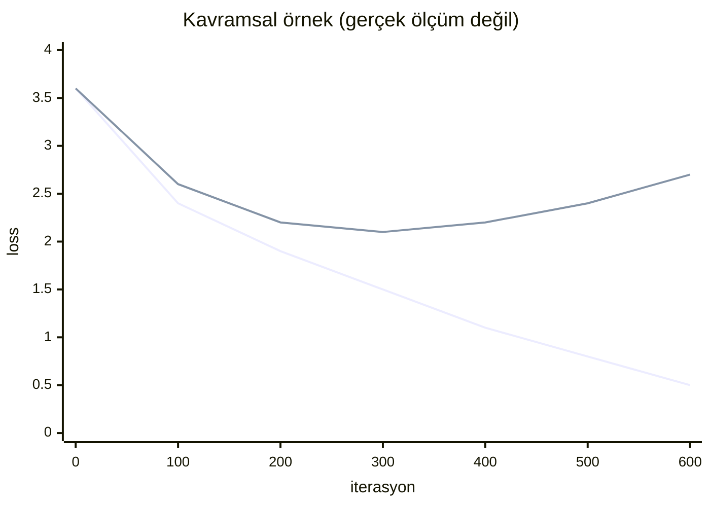

# 02 · Dataset Preparation

[← README](../README.md)

> Durum (25 Kasım 2026): Bu doküman veri hazırlama standardını tanımlar. Standardın ilk uygulaması `training/prepare_data.py` ile Türkçe hukuk verisi üzerinde yapıldı (temizlik, tekrar silme, gruplu split, yakın tekrar sızıntı kontrolü, token istatistikleri); ayrıntılar [10-law-qa-experiment.md §3](10-law-qa-experiment.md#3-veri). Bu dosyadaki "Örnek A.Ş." kayıtları **sentetiktir**; gerçek bir şirket değildir.

---

## 1. Train, validation ve test setlerinin amacı

| Set | MLX-LM dosya adı | Ne için kullanılır | Eğitim sırasında görülür mü? |
|---|---|---|---|
| **Train** | `train.jsonl` | Gradyan hesaplanır, adapter ağırlıkları bu veriyle güncellenir. | Evet, her adımda |
| **Validation** | `valid.jsonl` | Eğitim sırasında genelleme izlenir. Hangi checkpoint'in seçileceğine ve hiperparametrelere bu set ile karar verilir. | Evet, ama yalnızca loss ölçmek için (gradyan yok) |
| **Test** | `test.jsonl` | **En son**, bir kez ölçülür. Raporlanan nihai sonuçtur. | Hayır |

**Kural:** Test seti hiperparametre seçmek için kullanılırsa artık "test" değildir. O durumda sonuçlar iyimser çıkar. Bu, en yaygın değerlendirme hatasıdır.

**[Kod]** MLX-LM `--data` klasöründe `train.jsonl` ve `valid.jsonl` dosyalarını, `--test` için de `test.jsonl` dosyasını arar.

## 2. JSONL formatları

JSONL: her satır bağımsız bir JSON nesnesidir. MLX-LM 0.32.2 üç format tanır (`tuner/datasets.py`):

| Format | Anahtar | Kullanım |
|---|---|---|
| Chat | `{"messages": [...]}` (isteğe bağlı `"tools"`) | **Önerilen.** Modelin kendi chat template'i uygulanır. |
| Completions | `{"prompt": "...", "completion": "..."}` | Tek tur soru-cevap. İçeride user/assistant mesajlarına çevrilir. |
| Text | `{"text": "..."}` | Ham metin. Template uygulanmaz. |

### Örnek: chat formatı (sentetik)

```jsonl
{"messages": [{"role": "system", "content": "Sen Örnek A.Ş.'nin İK asistanısın. Yalnızca şirket politikalarına dayanarak, kısa ve Türkçe cevap ver."}, {"role": "user", "content": "Yıllık izin hakkım kaç gün?"}, {"role": "assistant", "content": "Örnek A.Ş. İzin Politikası (v3, madde 2.1) uyarınca 1–5 yıl kıdemi olan çalışanlar yılda 14 iş günü ücretli izin hakkına sahiptir."}]}
{"messages": [{"role": "system", "content": "Sen Örnek A.Ş.'nin İK asistanısın. Yalnızca şirket politikalarına dayanarak, kısa ve Türkçe cevap ver."}, {"role": "user", "content": "Uzaktan çalışma için kimden onay almalıyım?"}, {"role": "assistant", "content": "Uzaktan Çalışma Prosedürü (madde 4) uyarınca doğrudan yöneticinizin onayı gerekir. Haftada 2 günü aşan talepler ayrıca İK onayına tabidir."}]}
{"messages": [{"role": "system", "content": "Sen Örnek A.Ş.'nin İK asistanısın. Yalnızca şirket politikalarına dayanarak, kısa ve Türkçe cevap ver."}, {"role": "user", "content": "Şirketin 2027 kâr hedefi nedir?"}, {"role": "assistant", "content": "Bu bilgi bana sağlanan politika dokümanlarında yer almıyor. Finans departmanına danışmanızı öneririm."}]}
```

Üçüncü örnek bilinçli bir **abstention** (cevap vermeme) örneğidir. Veri setinde "bilmiyorum" örnekleri yoksa, model her soruya bir cevap uydurmayı öğrenir. Bkz. [05-evaluation.md](05-evaluation.md) → abstention accuracy.

### Referans projeyle karşılaştırma

**[Referans]** `ss/csv_to_jsonl.py` şunları yapar:
- `Question` ve `Answer` sütunlu bir CSV okur.
- Her satıra **sabit** bir sistem mesajı ekler.
- `sklearn.train_test_split(random_state=42)` ile önce %80 / %20, sonra kalan %20'yi %10 / %10 olarak böler.

Script'te duplicate, leakage veya token uzunluğu kontrolü yoktur. README, Llama 3 template'inin uygulandığını söyler. Ancak kod model-bağımsız `messages` formatı üretir; template'i eğitim sırasında MLX-LM uygular.

## 3. Chat template

**[Kod]** `ChatDataset`, her kaydı `tokenizer.apply_chat_template(messages)` ile tokenize eder. Yani:

1. Veriyi **kendi elinle** `<|start_header_id|>…` formatına çevirme. `messages` listesi ver, template'i tokenizer uygular.
2. Eğitimde kullanılan template ile inference'ta kullanılan template **aynı olmalıdır**. Bizim backend'imiz de `apply_chat_template` kullanır, dolayısıyla bu koşul sağlanır.
3. **Llama 3.2'ye özgü durum:** Template sistem bloğuna `Cutting Knowledge Date: December 2023` ve `Today Date: <bugün>` satırlarını ekler **[Ölçüm]**. Bunun iki sonucu vardır:
   - Aynı veri farklı günlerde tokenize edilince birkaç token farklı olur. Deneyler arası tam tekrarlanabilirlik için bu durum not edilmelidir.
   - Her örneğe yaklaşık 20–30 token sabit yük eklenir. Bu yük token bütçesinde hesaba katılmalıdır.

Referans projedeki `--use-default-chat-template` bayrağı 0.32.2'de hâlâ mevcuttur. Ancak modelin kendi template'i yerine varsayılan bir template kullanır. Llama 3.2 için bu bayrağı **kullanmamalıyız**.

## 4. Dataset split

Önerilen oran: **80 / 10 / 10** (train / valid / test). Referans proje de bu oranı kullanır.

Küçük verilerde oran yerine **mutlak sayı** önemlidir:

| Toplam kayıt | Train | Valid | Test | Not |
|---|---|---|---|---|
| 300 | 240 | 30 | 30 | Test istatistiksel olarak zayıf. Güven aralığı geniş olur. |
| 1 000 | 800 | 100 | 100 | |
| 5 000 | 4 000 | 500 | 500 | Valid ve test için %5 da yeterli olabilir. |

**Stratified split:** Veri kategorilere ayrılıyorsa (İK, finans, IT gibi), her kategori üç sette de aynı oranda bulunmalıdır.

**Grup bazlı split:** Aynı kaynak dokümandan üretilmiş soruların hepsi **aynı** sette olmalıdır. Aksi hâlde model test sorusunun cevabını train setindeki kardeş sorudan ezberler. Bu bir leakage türüdür.

## 5. Veri kalitesi

Kontrol listesi:

- [ ] Cevaplar doğru ve güncel mi? Uzman tarafından kontrol edildi mi?
- [ ] Cevaplar istenen **stile** uygun mu (uzunluk, ton, dil)?
- [ ] Sistem mesajı tüm kayıtlarda tutarlı mı? Inference'taki sistem mesajıyla aynı mı?
- [ ] Encoding UTF-8 mi? Türkçe karakterler bozulmamış mı (`ensure_ascii=False`)?
- [ ] Boş, kesik veya şablon kalıntısı ("{answer}") içeren kayıt var mı?
- [ ] Kişisel veri (ad, TC kimlik no, telefon, IBAN) maskelendi mi?
- [ ] Cevapsız (abstention) örnekler var mı? Oranları gerçek kullanımı yansıtıyor mu?

**Kalite > miktar.** 500 temiz örnek, 5 000 gürültülü örnekten genellikle daha iyi sonuç verir. Bu genel bir gözlemdir, bizim ölçümümüz değil.

## 6. Token uzunlukları

Neden ölçülmeli?
- `max_seq_length` seçimi bu ölçüme dayanır.
- **[Kod]** `max_seq_length` değerini aşan örnekler **sessizce kesilir**. Yalnızca bir `[WARNING]` satırı yazılır. Kesilen kısım genellikle cevabın sonudur, yani en önemli kısımdır.
- Eğitim süresi ve bellek token sayısıyla orantılıdır.

Ölçüm betiği (henüz projede yok, plan):

```python
"""Token length statistics for a chat JSONL file (planned: backend/scripts/token_stats.py)."""
import json, sys, statistics
from mlx_lm import load

_, tok = load("models/Llama-3.2-1B-Instruct-4bit")
lengths = []
for line in open(sys.argv[1], encoding="utf-8"):
    msgs = json.loads(line)["messages"]
    lengths.append(len(tok.apply_chat_template(msgs)))
lengths.sort()
p = lambda q: lengths[int(q * (len(lengths) - 1))]
print(f"n={len(lengths)} mean={statistics.mean(lengths):.0f} p50={p(.5)} p95={p(.95)} max={lengths[-1]}")
```

**Karar kuralı (öneri):** `max_seq_length` ≥ max uzunluk olmalıdır. Max çok uç bir değerse, o birkaç örneği bölmek veya çıkarmak, herkes için uzun dizi taşımaktan daha ucuzdur.

**[Referans]** Eğitmen her kaydın 200 token'ı aşmadığını hesapladığını ve `max_seq_length = 2048` seçtiğini yazıyor. Notebook log'u bununla tutarlı: 10. adımda 13 874 eğitilmiş token var. Bu, adım başına ~1 387 token demektir ve batch 8 için örnek başına ~173 token eder.

## 7. Data leakage

Leakage, test veya validation setindeki bilginin bir şekilde eğitime sızmasıdır. Sonuçlar gerçekte olduğundan iyi görünür.

| Leakage türü | Örnek | Önlem |
|---|---|---|
| Birebir tekrar | Aynı soru-cevap hem train hem test setinde | Split'ten **önce** exact dedup |
| Yakın tekrar | "İzin hakkım kaç gün?" / "Kaç gün iznim var?" | Near-duplicate tespiti, grup bazlı split |
| Kaynak paylaşımı | Aynı paragraftan türetilen sorular farklı setlerde | Kaynak dokümana göre grup split |
| Zaman | Test, train'den eski bilgiyi soruyor | Zamana göre split (en yeni veri test setinde) |
| Ön eğitim (pre-training) | Test sorusu internette yayınlanmış ve base model onu görmüş | Kurum içi, yayınlanmamış test soruları kullan |
| Hiperparametre seçimi | Test seti ile en iyi checkpoint'i seçmek | Seçim yalnızca validation ile yapılır |

## 8. Duplicate detection

Üç katmanlı yaklaşım:

1. **Exact:** Metni normalize et (küçük harf, boşlukları sadeleştir, Unicode NFC), SHA-256 hash'ini al, aynı hash'leri ele.
2. **Near-duplicate (sözcüksel):** Karakter n-gram'ları üzerinde Jaccard benzerliği. Büyük veride MinHash + LSH ile yapılır. Eşik örneği: Jaccard ≥ 0.8.
3. **Semantik:** Yerel bir embedding modeli ile cosine benzerliği. Örneğin ≥ 0.95 olan çiftler insan tarafından incelenir.

Bu kontroller hem **set içinde** hem **setler arasında** (train ↔ test) yapılır. Setler arası kontrol leakage testidir.

$$\text{Jaccard}(A, B) = \frac{|A \cap B|}{|A \cup B|}$$

## 9. Overfitting ve underfitting



| Durum | Belirti | Olası sebep | Müdahale |
|---|---|---|---|
| **Underfitting** | Train ve validation loss ikisi de yüksek ve hâlâ düşüyor | Çok az adım, çok düşük LR, çok düşük rank | `iters` artır, LR'yi biraz artır, rank veya num_layers artır |
| **İyi uyum** | Validation loss düşüp yataylaşıyor, train loss'a yakın | | Validation minimumundaki checkpoint'i seç |
| **Overfitting** | Train loss düşmeye devam ederken validation loss yükseliyor | Çok fazla epoch, küçük veri, yüksek rank | Daha az epoch, en iyi checkpoint'i seç, dropout, daha fazla veri |

Yukarıdaki grafik **kavramsaldır**, ölçülmüş bir eğri değildir.

**Gözlem [Referans]:** Referans notebook'ta ilk validation loss 3.905 ve eğitim sonrası test loss 3.945. Train loss ise 190. adımda ~1.7'ye inmiş. Train loss belirgin düşerken held-out loss'un yerinde kalması bir overfitting **belirtisi olabilir**. Ancak log tam değil ve ara validation değerleri görünmüyor, bu yüzden bu bir kesin sonuç değildir. Ayrıntı: [07-reference-project-analysis.md](07-reference-project-analysis.md).

## 10. Assistant-only loss masking

**[Teori]** Varsayılan durumda loss, dizideki **tüm** tokenlar üzerinden hesaplanır: sistem mesajı, kullanıcı sorusu ve cevap. Oysa amaç modelin **cevap üretmeyi** öğrenmesidir. Sistem mesajını ve soruyu tahmin etmeyi öğrenmesi amaç değildir.

**[Kod]** MLX-LM 0.32.2'de `--mask-prompt` bayrağı vardır (referans notebook'taki eski sürümün help çıktısında bu bayrak yoktu). Davranışı:

```python
# ChatDataset.process
offset = len(tokenizer.apply_chat_template(messages[:-1], add_generation_prompt=True))
# default_loss
mask = (steps >= offset) & (steps <= length)    # yalnızca son mesajın tokenları
```

Sonuçlar:
- Loss yalnızca **son** mesajın (assistant) tokenları üzerinden hesaplanır.
- Çok turlu konuşmada önceki assistant cevapları da maskelenir. Yalnızca son tur öğretilir.
- Loss değerleri maskesiz eğitimle **karşılaştırılamaz**. Payda farklıdır, ayrıca sabit sistem mesajı kolay tahmin edildiği için maskesiz loss yapay olarak düşük görünür.

**Öneri:** Tüm deneylerde `mask_prompt: true`. Bu ayar deneyler arasında **sabit** tutulmalıdır.

Örnek: sistem + soru 60 token, cevap 40 token.

| | Loss'a giren token | Etki |
|---|---|---|
| Maskesiz | 100 | Loss'un %60'ı tekrarlayan prompt'tan gelir |
| `--mask-prompt` | 40 | Loss doğrudan cevap kalitesini yansıtır |

## 11. Hassas şirket verilerinin korunması

- Veri yalnızca `data/` klasöründe tutulur. Bu klasör `.gitignore` içindedir.
- Eğitim öncesi **PII maskeleme** yapılır: ad → `[AD]`, TC kimlik no → `[TCKN]`, IBAN → `[IBAN]`.
- Adapter dosyaları eğitim verisini **ezberleyebilir**. Adapter da veri kadar hassastır ve aynı erişim kontrolüne tabidir.
- Test setine "üyelik çıkarımı" (membership inference) kontrolü eklenebilir: eğitim örneğinin bir kısmı verilir, model devamını birebir üretiyor mu diye bakılır.
- Ayrıntı: [08-security-and-offline-operation.md](08-security-and-offline-operation.md).

## 12. Veri seti boyutuna göre örnek planlar

**[Öneri]** Aşağıdakiler başlangıç noktalarıdır, kesin reçete değildir. Hesap ayrıntısı için bkz. [04-training-calculations.md](04-training-calculations.md).

| Plan | Train örneği | Hedef | Öneri |
|---|---|---|---|
| **A · Pilot** | 100–300 | Format ve stil uyarlaması (örneğin "her cevapta madde numarası ver") | rank 4–8, num_layers 8, 2–3 epoch, sık validation |
| **B · Görev** | ~1 000 | Belirli bir görevde tutarlı davranış (sınıflandırma, yapılandırılmış çıktı) | rank 8, num_layers 16, 2–4 epoch |
| **C · Alan** | ~5 000 | Alan dili ve terminolojisi | rank 8–16, 1–2 epoch, validation'a göre erken durdurma |

Hiçbir plan RAG'in yerini tutmaz. Değişen bilgi (fiyat, politika sürümü, kişi) RAG ile verilmelidir, ağırlıklara gömülmemelidir.

---

## Kaynaklar

- MLX-LM kaynak kodu: `mlx_lm/tuner/datasets.py`, `mlx_lm/tuner/trainer.py` (0.32.2)
- Referans: `MoAshour93/MLX_Finetuning/ss/csv_to_jsonl.py`
- Broder, *On the resemblance and containment of documents* (MinHash), 1997
- Lee et al., *Deduplicating Training Data Makes Language Models Better*, 2022. arXiv:2107.06499
