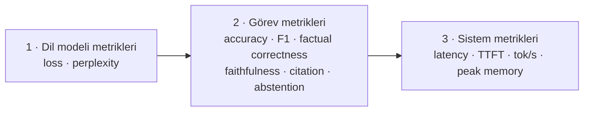

# 05 · Evaluation and Model Reliability

[← README](../README.md)

> Durum (25 Kasım 2026): API performans metriklerini (`tokens_per_second`, `elapsed_seconds`, `peak_memory_gb` vb.) döndürüyor. `training/evaluate.py` test loss, perplexity, exact match, Token F1, ROUGE-L, uzunluk oranı ve RAG için answer support@k metriklerini ölçüyor; ilk sonuçlar [10-law-qa-experiment.md](10-law-qa-experiment.md) dosyasında. Factual correctness, faithfulness, citation accuracy ve insan değerlendirmesi **planlandı**.

## 0. Temel ilke

> **Düşük loss veya düşük perplexity, yüksek factual correctness anlamına gelmez.**

Loss, modelin referans metindeki tokenları **ne kadar olası bulduğunu** ölçer. Akıcı, emin ve tamamen yanlış bir cevap da düşük loss alabilir. Örneğin cevap "...yılda **14** iş günü..." iken model "...yılda **21** iş günü..." derse, cümlenin yalnızca tek bir token'ı yanlıştır. Token ortalamalı loss bu hatayı neredeyse fark etmez, ama cevap tamamen yanlıştır.

Bu yüzden değerlendirme üç katmanda yapılır:

---

## 1. Dil modeli metrikleri

### Training loss

$$\mathcal{L}_{train} = -\frac{1}{|M|}\sum_{(b,i)\in M} \log p_\theta(y_{b,i} \mid y_{b,<i})$$

Burada $M$ maskelenmiş token kümesidir.
- **[Kod]** MLX-LM her `steps_per_report` adımda son adımların **ortalamasını** yazdırır.
- **Sınırı:** Model bu verileri görmüştür. Train loss'un düşmesi öğrenildiğini gösterir, genelleme yapıldığını göstermez.

### Validation loss

Aynı formüldür, ama eğitimde gradyanı kullanılmayan `valid.jsonl` üzerinden hesaplanır. **[Kod]** Token ağırlıklı ortalamadır: $\sum_b \mathcal{L}_b \cdot n_b / \sum_b n_b$.
- **Kullanımı:** Checkpoint seçimi (early stopping) ve hiperparametre karşılaştırması.
- **Sınırı:** Seçim için kullanıldığı için, seçilen modelin validation skoru iyimser bir tahmindir.

### Test loss

`mlx_lm.lora --test` komutu `test.jsonl` üzerinde aynı loss'u hesaplar. Yalnızca **son** modelde, **bir kez** ölçülür.

**[Referans]** `Test loss 3.945, Test ppl 51.684`.

### Perplexity

$$\mathrm{PPL} = \exp(\mathcal{L})$$

Sınırları:
- **Tokenizer'a bağlıdır.** Farklı vocab'a sahip modeller (Llama 128 256, Mistral 32 768, Qwen 151 936) PPL ile **karşılaştırılamaz**. Daha büyük token parçaları, token başına daha yüksek belirsizlik demektir.
- Aynı test seti, aynı template ve aynı `mask_prompt` ayarı olmadan karşılaştırılamaz.
- **[Referans]** Eğitmenin eşikleri ("< 20 mükemmel", "40–60 orta" vb.) **eğitmenin yorumudur**. Bu eşikler genel bir standart değildir ve veri setine, tokenizer'a ve maskelemeye bağlıdır.

---

## 2. Görev metrikleri

### Hangi metrik hangi görevde anlamlı?

| Görev tipi | Örnek | Anlamlı metrikler |
|---|---|---|
| Sınıflandırma | Destek talebi → {IT, İK, Finans} | Accuracy, precision, recall, F1 (sınıf başına ve macro) |
| Bilgi çıkarma | Sözleşmeden tarih, tutar, taraf | Alan bazında exact match, precision, recall, F1 |
| Kısa cevaplı QA | "İzin kaç gün?" → "14 iş günü" | Exact match, token-F1, factual correctness |
| Uzun / serbest cevap | Politika açıklaması | Factual correctness (iddia bazında), answer relevance, insan puanı |
| RAG | Dokümana dayalı cevap | Faithfulness, citation accuracy, context precision/recall, hallucination rate |
| Cevapsız sorular | Kapsam dışı soru | Abstention accuracy |

Precision, recall ve F1, **ayrık ve sayılabilir** çıktılar (sınıflar, alanlar, iddialar, kaynaklar) olduğunda anlamlıdır. Serbest metnin tamamına doğrudan uygulanmazlar. Önce cevap sayılabilir birimlere (iddialar, alanlar) ayrılır.

### Accuracy

$$\text{Accuracy} = \frac{\text{doğru}}{\text{toplam}}$$

**Sınırı:** Dengesiz sınıflarda yanıltıcıdır. Örneğin taleplerin %90'ı IT ise, her şeye "IT" diyen bir model %90 accuracy alır.

### Precision, recall, F1

$$P = \frac{TP}{TP+FP}, \qquad R = \frac{TP}{TP+FN}, \qquad F_1 = \frac{2PR}{P+R}$$

**Örnek (Finans sınıfı):** 40 gerçek Finans talebi var. Model 50 talebe "Finans" diyor ve bunların 32'si doğru.

$$P = 32/50 = 0.64, \quad R = 32/40 = 0.80, \quad F_1 = \frac{2 \cdot 0.64 \cdot 0.80}{1.44} = 0.711$$

- **Macro-F1:** sınıf F1'lerinin ortalaması. Küçük sınıfları korur.
- **Micro-F1:** tüm TP, FP ve FN değerleri toplanarak hesaplanır.
- **Token-F1 (QA):** Cevap ve referans token kümeleri üzerinden hesaplanır (SQuAD tarzı). Yüzeysel bir ölçüdür: "14 gün" ile "on dört gün" düşük puan alır.

### Factual correctness

Cevaptaki **atomik iddialar** referans gerçeklerle karşılaştırılır (FActScore yaklaşımı, Min et al., 2023).

$$\text{FactCorr} = \frac{\#\text{doğru iddia}}{\#\text{toplam iddia}}$$

**Örnek:** "14 iş günü izin hakkınız var (doğru) ve bu hak 1 yıl sonra başlar (yanlış)" → $1/2 = 0.5$.

**Sınırı:** İddiaya ayırma işlemi ve doğrulama ya insan ya da bir değerlendirici model ister. Değerlendirici model de hata yapar. Bu yüzden bir alt küme mutlaka insan tarafından doğrulanmalıdır.

### Answer relevance

Cevap soruyu gerçekten yanıtlıyor mu? Doğru ama alakasız bir cevap düşük puan alır.

- İnsan puanı (1–5 arası) veya değerlendirici model puanı.
- RAGAS yaklaşımı: cevaptan geriye sorular üretilir ve bunların orijinal soruya embedding benzerliği ölçülür (Es et al., 2023).

**Sınırı:** Doğruluk ölçmez. Alakalı ama yanlış bir cevap yüksek puan alabilir.

### Faithfulness (RAG)

Cevaptaki iddiaların, **verilen bağlamla** desteklenme oranı:

$$\text{Faithfulness} = \frac{\#\text{bağlamla desteklenen iddia}}{\#\text{toplam iddia}}$$

**Factual correctness'tan farkı:** Faithfulness, kaynağa sadakati ölçer. Bağlam yanlışsa, kaynağa sadık bir cevap da yanlış olur. İki metrik birlikte raporlanmalıdır.

### Citation accuracy

Cevap kaynak gösteriyorsa:

$$\text{Citation precision} = \frac{\#\text{iddiayı gerçekten destekleyen atıf}}{\#\text{toplam atıf}}, \qquad \text{Citation recall} = \frac{\#\text{atıfla desteklenen iddia}}{\#\text{atıf gerektiren iddia}}$$

**Örnek:** Cevap 3 atıf içeriyor ve 2'si doğru paragrafı gösteriyor → precision 0.67. Atıf gerektiren 4 iddiadan 2'sinin atfı var → recall 0.5.

### Hallucination rate

İki yaygın tanım vardır. Hangisinin kullanıldığı **raporda belirtilmelidir**:

$$\text{HR}_{iddia} = \frac{\#\text{desteklenmeyen iddia}}{\#\text{toplam iddia}} \qquad \text{HR}_{cevap} = \frac{\#\text{en az bir desteklenmeyen iddia içeren cevap}}{\#\text{cevap}}$$

### Abstention accuracy

Test setine bilinçli olarak **cevaplanamaz** sorular eklenir (bilgi kaynakta yok veya kapsam dışı).

| | Model cevapladı | Model "bilmiyorum" dedi |
|---|---|---|
| **Cevaplanabilir** | ✅ (doğruluğu ayrıca ölçülür) | ❌ aşırı çekingenlik |
| **Cevaplanamaz** | ❌ uydurma | ✅ doğru abstention |

$$\text{Abstention accuracy} = \frac{\#\text{doğru reddedilen cevaplanamaz soru}}{\#\text{cevaplanamaz soru}}, \qquad \text{Over-abstention} = \frac{\#\text{reddedilen cevaplanabilir soru}}{\#\text{cevaplanabilir soru}}$$

İki değer birlikte raporlanmalıdır. Her soruya "bilmiyorum" diyen bir model %100 abstention accuracy alır.

---

## 3. Sistem metrikleri

| Metrik | Tanım | Projede durum |
|---|---|---|
| **Latency** | İstek ile tam cevap arasındaki süre | ✅ `elapsed_seconds` (sunucu tarafı, yalnızca üretim süresi) |
| **TTFT** (time to first token) | İstek ile ilk token arasındaki süre. Yaklaşık olarak prompt işleme (prefill) süresidir. | ❌ Ölçülmüyor. Streaming eklendiğinde ilk `stream_generate` parçasının zamanı alınacak. |
| **Tokens per second** | Üretim hızı: $\dfrac{\text{üretilen token}}{\text{üretim süresi}}$ | ✅ `tokens_per_second` (= MLX-LM `generation_tps`) |
| **Prompt TPS** | Prefill hızı | ⏳ MLX-LM `prompt_tps` alanı var, API'de henüz döndürülmüyor |
| **Peak memory** | Üretim sırasındaki en yüksek MLX bellek kullanımı | ✅ `peak_memory_gb` |

$$\text{Latency} \approx \text{TTFT} + \frac{n_{gen}}{\text{TPS}}$$

**[Ölçüm]** 1B 4-bit: `mlx_lm.generate` ile 160.4 token/sn ve 0.861 GB. Backend üzerinden 114–139 token/sn, 0.85–0.86 GB. Çok kısa cevaplarda TPS değeri gürültülüdür. Karşılaştırma için sabit uzunlukta üretim (`mlx_lm.benchmark`) kullanılmalıdır.

**Ölçüm kuralları:**
- İlk istek, ısınma (warm-up) olarak sayılmaz.
- Her ölçüm en az 5 kez tekrarlanır ve medyan raporlanır.
- Aynı prompt uzunluğu, aynı `max_tokens` ve `temperature = 0` kullanılır.
- MacBook Air termal kısıtlamaya girebilir, bu yüzden uzun serilerde sıcaklık etkisi not edilmelidir.

---

## 4. Değerlendirme protokolü (planlanan)

1. **Sabit test seti:** `data/eval/test.jsonl`. Hiçbir eğitimde kullanılmaz ve versiyonlanır.
2. **Sabit inference ayarları:** `temperature = 0` (greedy), sabit `max_tokens`, sabit sistem mesajı, aynı chat template.
3. **Otomatik metrikler:** Loss/PPL (`mlx_lm.lora --test`), exact match, F1, abstention.
4. **Model destekli metrikler:** Faithfulness ve factual correctness. Değerlendirici model de **yerel** çalışmalıdır; aksi hâlde veri dışarı çıkar.
5. **İnsan değerlendirmesi:** Rastgele 50 cevap, kör (hangi modelin ürettiği gizli), iki değerlendirici. Değerlendiriciler arası uyum (Cohen's κ) raporlanır.
6. **İstatistik:** Küçük test setlerinde fark anlamlı olmayabilir. Paired bootstrap ile %95 güven aralığı raporlanır.

### Küçük test setinde belirsizlik

$n$ soruluk bir test setinde accuracy için standart hata:

$$SE = \sqrt{\frac{p(1-p)}{n}}$$

**Örnek:** $n = 100$, $p = 0.70$ → $SE = 0.046$, %95 güven aralığı yaklaşık ±9 puan. Bu durumda %70 ile %75 arasındaki fark **anlamlı olmayabilir**.

---

## Kaynaklar

- Min et al., *FActScore: Fine-grained Atomic Evaluation of Factual Precision*, 2023. arXiv:2305.14251
- Es et al., *RAGAS: Automated Evaluation of Retrieval Augmented Generation*, 2023. arXiv:2309.15217
- Rajpurkar et al., *SQuAD*, 2016. arXiv:1606.05250
- Efron & Tibshirani, *An Introduction to the Bootstrap*, 1993
- MLX-LM: `mlx_lm.lora --test`, `mlx_lm.perplexity`, `mlx_lm.evaluate`, `mlx_lm.benchmark` (0.32.2'de mevcut)
