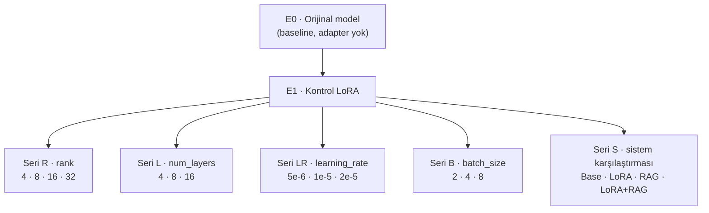

# 06 · Experimental Design

[← README](../README.md)

> Durum (25 Kasım 2026): Bu doküman genel deney planıdır. İlk uygulaması Türkçe hukuk verisiyle yapıldı: kontrol eğitimi ve Base / LoRA / RAG / LoRA+RAG karşılaştırması tamamlandı, hiperparametre serisi sürüyor. Ölçülen sonuçlar [10-law-qa-experiment.md](10-law-qa-experiment.md) dosyasındadır. Aşağıdaki tablolardaki boş hücreler (`—`) planın genel şablonudur; tahmini veya örnek sonuç yazılmamıştır.

---

## 1. İlkeler

1. **Tek bağımsız değişken.** Her deney serisinde yalnızca bir parametre değişir. Diğerleri **kontrol konfigürasyonunda** sabit kalır.
2. **Aynı test seti.** Tüm deneyler aynı, dondurulmuş `data/eval/test.jsonl` ile ölçülür.
3. **Aynı inference ayarları.** `temperature = 0`, aynı `max_tokens`, aynı sistem mesajı, aynı chat template.
4. **Seçim validation ile yapılır.** Her deneyin "en iyi checkpoint"i validation loss'a göre seçilir. Test seti yalnızca son raporda kullanılır.
5. **Tekrar.** Fark küçükse deney 3 farklı seed ile tekrarlanır ve ortalama ± standart sapma raporlanır.
6. **Kayıt.** Her deneyin `adapter_config.json` dosyası, eğitim log'u ve donanım durumu saklanır.

## 2. Kontrol konfigürasyonu

Tüm seriler bu konfigürasyondan tek bir değişkeni değiştirerek türetilir. Bkz. [03 §4.2](03-fine-tuning-configuration.md#42-dengeli-eğitim-ilk-ana-deney).

| Parametre | Kontrol değeri |
|---|---|
| model | Llama 3.2 1B Instruct 4-bit |
| fine_tune_type | lora |
| num_layers | 16 |
| rank / scale / dropout | 8 / 20.0 / 0.0 |
| keys | varsayılan (7 lineer katman) |
| batch_size × accum | 4 × 1 |
| learning_rate | 1e-5 (sabit) |
| iters | 3 epoch |
| mask_prompt | true |
| max_seq_length | 2048 |
| grad_checkpoint | true |
| seed | 42 |

## 3. Deney haritası



## 4. Deney serileri ve boş sonuç tabloları

Ortak metrik sütunları:
- **Val loss (min):** En iyi checkpoint'teki validation loss.
- **Test loss / PPL:** `mlx_lm.lora --test` ile ölçülür.
- **Görev skoru:** Görev tipine göre EM, F1 veya FactCorr ([05](05-evaluation.md)).
- **Abst. acc.:** Abstention accuracy.
- **Peak mem (train):** Log'daki `Peak mem` değeri.
- **Süre:** Eğitimin toplam duvar saati süresi.

### E0 · Orijinal model (baseline)

Adapter yok. Aynı test seti ve aynı inference ayarları. Bu satır, tüm iyileştirmelerin karşılaştırma noktasıdır.

| Model | Test loss | Test PPL | Görev skoru | FactCorr | Abst. acc. | TPS (inference) | Peak mem (inference) |
|---|---|---|---|---|---|---|---|
| Llama 3.2 1B 4-bit | — | — | — | — | — | — | — |
| Llama 3.2 3B 4-bit | — | — | — | — | — | — | — |
| Qwen3 4B 4-bit | — | — | — | — | — | — | — |

### Seri R · LoRA rank

Bağımsız değişken: `lora_parameters.rank`. Diğer her şey kontrol konfigürasyonudur.

| Deney | rank | Eğitilebilir param. | Val loss (min) | En iyi iter | Test loss | Görev skoru | Peak mem (train) | Süre |
|---|---|---|---|---|---|---|---|---|
| R-4 | 4 | 2 818 048 | — | — | — | — | — | — |
| R-8 (= E1) | 8 | 5 636 096 | — | — | — | — | — | — |
| R-16 | 16 | 11 272 192 | — | — | — | — | — | — |
| R-32 | 32 | 22 544 384 | — | — | — | — | — | — |

Eğitilebilir parametre sütunu hesaplanmıştır (num_layers = 16). Ölçüm değil, yapısal bir değerdir.

**Hipotez (doğrulanmadı):** Küçük veride rank artışı validation loss'u bir noktaya kadar iyileştirir, sonra overfitting başlar.

### Seri L · LoRA uygulanan katman sayısı

Bağımsız değişken: `num_layers`. Modelin toplam katman sayısı sabittir (16). Rank sabittir (8).

| Deney | num_layers | Uyarlanan bloklar | Eğitilebilir param. | Val loss (min) | Test loss | Görev skoru | Peak mem (train) | Süre |
|---|---|---|---|---|---|---|---|---|
| L-4 | 4 | 12–15 | 1 409 024 | — | — | — | — | — |
| L-8 | 8 | 8–15 | 2 818 048 | — | — | — | — | — |
| L-16 (= E1) | 16 | 0–15 | 5 636 096 | — | — | — | — | — |

### Seri LR · Learning rate

| Deney | learning_rate | Val loss (min) | En iyi iter | Loss eğrisi kararlı mı? | Test loss | Görev skoru |
|---|---|---|---|---|---|---|
| LR-5e-6 | 5e-6 | — | — | — | — | — |
| LR-1e-5 (= E1) | 1e-5 | — | — | — | — | — |
| LR-2e-5 | 2e-5 | — | — | — | — | — |

### Seri B · Batch size

Seçilecek kontrol yöntemi: **epoch sayısı sabit** (3 epoch). `iters` değeri her batch boyutu için yeniden hesaplanır. Bu seçim, batch etkisini "görülen veri miktarı" etkisinden ayırır. Hangi yöntemin seçildiği raporda belirtilmelidir.

| Deney | batch_size | iters (3 epoch, N=800) | Val loss (min) | Test loss | Görev skoru | Peak mem (train) | Süre |
|---|---|---|---|---|---|---|---|
| B-2 | 2 | 1 200 | — | — | — | — | — |
| B-4 (= E1) | 4 | 600 | — | — | — | — | — |
| B-8 | 8 | 300 | — | — | — | — | — |

Not: Batch boyutu ile learning rate etkileşir. Sabit LR ile yapılan bu seri, "batch boyutunun tek başına etkisini" ölçer. "Her batch için en iyi LR" sorusunu cevaplamaz.

### Seri S · Sistem karşılaştırması: Base, LoRA, RAG, LoRA + RAG

RAG Faz 9'da kurulduktan sonra çalıştırılabilir. Bağımsız değişken sistem tipidir. LoRA adapter'ı, seriler R/L/LR/B'den seçilen **en iyi** adapter'dır ve sabittir. Retriever ayarları (chunk boyutu, top-k, embedding modeli) sabittir.

| Sistem | FactCorr | Faithfulness | Citation P / R | Hallucination rate | Abst. acc. | Over-abst. | Answer relevance | Latency (medyan) | TTFT | Peak mem |
|---|---|---|---|---|---|---|---|---|---|---|
| Base (orijinal) | — | n/a | n/a | — | — | — | — | — | — | — |
| LoRA | — | n/a | n/a | — | — | — | — | — | — | — |
| RAG | — | — | — | — | — | — | — | — | — | — |
| LoRA + RAG | — | — | — | — | — | — | — | — | — | — |

Bağlam olmayan sistemlerde (Base, LoRA) faithfulness ve citation ölçülemez (`n/a`).

## 5. Deney kayıt şablonu

Her deney için `docs/experiments/<deney-id>.md` dosyası oluşturulacak (planlandı):

```markdown
# <deney-id>

- Tarih:
- Seri / bağımsız değişken:
- Kontrol konfigürasyonundan fark:
- Konfigürasyon dosyası: configs/<...>.yaml
- Adapter klasörü: adapters/<...>/
- Veri seti versiyonu (hash):
- mlx-lm sürümü:
- Donanım durumu (güç adaptörü, diğer uygulamalar kapalı mı):

## Sonuçlar
| iter | train loss | val loss | peak mem |
|---|---|---|---|

- En iyi checkpoint:
- Test loss / PPL:
- Görev metrikleri:

## Gözlemler
```

## 6. Tehditler (validity threats)

| Tehdit | Önlem |
|---|---|
| Test setinin seçimde kullanılması | Seçim yalnızca validation ile yapılır |
| Tek seed ile sonuç | Kritik farklarda 3 seed |
| Template tarihinin değişmesi (Llama "Today Date") | Tüm deneyleri aynı günde tokenize edin veya tarihi sabitleyin |
| Termal kısıtlama (MacBook Air) | Süreler göreli değerlendirilir; aynı koşullarda tekrar edilir |
| Değerlendirici model yanlılığı | İnsan değerlendirmesi ile bir alt küme doğrulanır |
| Küçük test seti | Güven aralığı raporlanır ([05 §4](05-evaluation.md)) |
