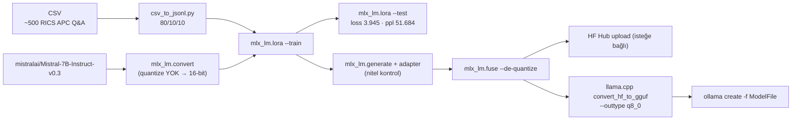

# 07 · Reference Project Analysis — MoAshour93/MLX_Finetuning

[← README](../README.md)

Bu doküman referans repoyu analiz eder. Eğitmenin **kendi yazdıkları** ile **bizim çıkarımlarımız** ayrı tutulmuştur.

| Kaynak | Erişim |
|---|---|
| GitHub repo (yerel kopya: `../MLX_Finetuning`) | ✅ Okundu |
| Jupyter notebook (37 hücre, çıktılar dahil) | ✅ Okundu |
| YouTube videosu `Tam_i5mkCiQ` | ❌ **İzlenemedi.** Videodan gelen bilgi yalnızca ekip notlarına dayanır. |

## 1. Repo içeriği

| Dosya | Ne yapar |
|---|---|
| `README.md` | Kurulum → veri → eğitim → test → fuse → GGUF → Ollama adımları |
| `Mistral_Instruct_v03_MLX_Finetuning-Github.ipynb` | Aynı süreç; yorumlu komutlar ve çıktılar ("Updated February 2025") |
| `ss/csv_to_jsonl.py` | CSV (Question, Answer) → `messages` JSONL, 80/10/10 split (`random_state=42`) |
| `llm_chat_template_converter.py` | Tkinter GUI: CSV veya Excel'e farklı model template'leri uygular, split oranları ayarlanabilir |
| `ss/Safetensors_to_bin.py` | Adapter `.safetensors` → PyTorch `adapter_model.bin` (pickle) |
| `Model Files/*` | Mistral, Llama 3.2 ve Qwen3 4B için Ollama `Modelfile` dosyaları |

## 2. Eğitmenin süreci

## 3. Eğitmenin parametre gerekçeleri (notebook hücre 13'ten)

Aşağıdaki gerekçeler **eğitmenin kendi yorumlarıdır**. Sağ sütunda bizim kontrolümüz yer alır.

| Parametre | Eğitmenin gerekçesi (özet) | Bizim kontrolümüz |
|---|---|---|
| `num_layers 16` | "Normalde toplam katmanların %40–80'i. Modelde 32 katman var, 16 seçtim." | Mistral 7B: 32 katman, doğru. %40–80 kuralı eğitmenin görüşüdür; MLX dokümantasyonunda yoktur. |
| `batch_size 16` | "Gradyan kararlılığı için 16. Bilmeyenler genelde 8 kullanır." | Hücre kodu 16, ama ölçülen çıktı log'u README'deki **8** ile uyumlu (bkz. §4). |
| `iters 200` | "MLX epoch argümanı vermiyor. 5–8 epoch hedefliyorum: 200 × 16 / 500 = 6.4 epoch." | Formül mantığı doğru. Ancak 500 **toplam** kayıt; train ~400. MLX-LM ile doğru hesap: $\lfloor 400/16 \rfloor = 25$ adım/epoch, $200/25 = 8.0$ epoch. |
| `learning_rate 2e-5` | "Base bilgiyi unutturmayacak, eğitimi de yavaşlatmayacak değer. Normal aralık 2e-5 – 4e-5." | Eğitmenin görüşü. MLX-LM varsayılanı 1e-5. Log'daki LR 1e-5. |
| `max_seq_length 2048` | "Her kayıt 200 token'ı aşmıyor, 2048 fazlasıyla yeterli." | Tutarlı. Log: adım başına ~1 387 token; batch 8 için örnek başına ~173 token. |
| `val_batches 4` | "Formül ceiling(validation kayıt / batch). Ceiling(500/16) = 4. 50 validation kaydım var (%10)." | $\lceil 500/16 \rceil = 32$, 4 değil. Kastedilen $\lceil 50/16 \rceil = 4$. MLX-LM aşağı yuvarladığı için gerçekte 3 batch (48 örnek) kullanılır. |
| `steps_per_eval 50` | "Formül max(50, iters//10): max(50, 250//10) = 50." | iters = 200 olmalıydı (250 yazılmış). Sonuç yine 50. Formül eğitmenin kendi kuralıdır. |
| `save_every 50` | "100 seçtim, en az 4 checkpoint olmalı… 50, 100, 150, 200." | Metin "100" diyor, kod ve checkpoint listesi 50 ile tutarlı. |
| `grad_checkpoint` | "Ara değerleri yeniden hesaplayarak bellek azaltır." | Doğru. |
| `seed 42` | "Tekrarlanabilirlik." | Doğru. |

Test komutu (hücre 15) için eğitmenin açıklaması: `--test` "final performance assessment" içindir ve validation'dan farklıdır. Bu ayrım doğrudur. Bkz. [02 §1](02-dataset-preparation.md#1-train-validation-ve-test-setlerinin-amacı).

## 4. Komut ile çıktının uyuşmazlığı

Notebook hücre 13'teki **komut** ile aynı hücrenin **çıktısı** farklı konfigürasyonları gösteriyor:

| | Hücre komutu | Hücre çıktısı |
|---|---|---|
| iters | 200 | `Starting training..., iters: 1000` |
| learning_rate | 2e-5 | `Learning Rate 1.000e-05` |

Çıktı, README'deki konfigürasyonla (`--batch-size 8 --iters 1000 --val-batches 50 --learning-rate 1e-5 --steps-per-eval 200 --save-every 500`) uyumlu.

**Çıkarımımız:** Hücre kodu, çıktı üretildikten sonra değiştirilmiş ve yeniden çalıştırılmamış. Bu yüzden:
- Video notlarındaki değerler (batch 16, iters 200, lr 2e-5) **hücre kodunu** yansıtıyor.
- Repodaki **ölçülmüş sonuçlar** README konfigürasyonuna ait.
- Batch 8 değeri log'dan doğrudan okunamıyor. Adım başına ~1 387 token, batch 8 ve ~173 token/örnek ile tutarlı. Bu bir çıkarımdır.

## 5. Referansın ölçülmüş sonuçları

| Ölçüm | Değer | Kaynak |
|---|---|---|
| Eğitilebilir parametre | 3.408 M / 7 248.024 M (%0.047) | Hücre 13 log |
| İlk validation loss | 3.905 | Hücre 13 log |
| Train loss (10. → 190. adım) | 3.213 → ~1.72 | Hücre 13 log (190'da kesilmiş) |
| Train peak memory | 18.217 → 20.094 GB | Hücre 13 log |
| Train throughput | ~260–287 token/sn, 0.155–0.249 it/sn | Hücre 13 log |
| Test loss / PPL | 3.945 / 51.684 | Hücre 15 |
| Inference (adapter ile) | 22.4–23.5 token/sn, peak 14.68 GB | Hücre 18–20 |
| Inference (fused, CLI) | 25.8 token/sn, peak 14.65 GB | Hücre 26 |
| Inference (fused, Python API) | 25.5 token/sn, peak 28.99 GB | Hücre 28 |
| Donanım | Belirtilmemiş. 20 GB eğitim peak'i, en az 32 GB belleği gösteriyor (çıkarım). | — |

### Sonuçların yorumu

**Eğitmenin yorumu:** Test loss 3.945 "orta performans" (eşikleri: <2.5 mükemmel, 2.5–3.5 iyi, 3.5–4.5 orta). Test PPL 51.68 "orta belirsizlik".

**Bizim gözlemlerimiz** (kesin sonuç değil, hipotez):
1. **Held-out loss iyileşmemiş görünüyor.** Eğitim öncesi validation loss 3.905, eğitim sonrası test loss 3.945. Train loss ise 3.2'den ~1.7'ye inmiş. Olası açıklamalar:
   - **Overfitting.** README konfigürasyonu ~400 örnek üzerinde **~20 epoch** yapar ($1000 \times 8 / 400$). Bu, küçük veri için yüksektir.
   - Validation ve test setleri farklı dağılımlar içeriyor olabilir.
   - Ara validation değerleri (200, 400, … adımlar) log'da görünmüyor, bu yüzden en iyi checkpoint bilinemiyor.
2. **Eşikler genel değildir.** "Loss < 2.5 mükemmel" gibi eşikler tokenizer'a, veriye ve maskelemeye bağlıdır.
3. **Maskeleme yok.** O sürümde `--mask-prompt` yoktu. Loss, uzun ve sabit sistem mesajını da içerir.
4. **Nitel değerlendirme.** Model çıktıları akıcı ve alan diline uygun görünüyor. Ancak doğruluk sistematik olarak ölçülmemiş (factual correctness, hallucination). Hücre 26'daki cevap 400 token sınırında kesilmiş ve tekrarlar içeriyor.
5. **Bellek farkı.** Python API ile fused inference 28.99 GB peak gösteriyor, CLI ile 14.65 GB. Bu fark açıklanmamış.

## 6. Sürüm farkları (Şubat 2025 → mlx-lm 0.32.2)

| Konu | Referans (Şubat 2025) | mlx-lm 0.32.2 (bizim) |
|---|---|---|
| `mlx_lm.lora` bayrakları | `--mask-prompt`, `--grad-accumulation-steps`, `--optimizer` **yok** | Üçü de var |
| `mlx_lm.fuse` | `--de-quantize`, `--hf-path` | `--dequantize`; `--hf-path` **yok** |
| `mlx_lm.convert` | `-q`, `--q-bits`, `--q-group-size` | Ek olarak `--q-mode`, `--quant-predicate` |
| Varsayılan LoRA hedefleri | Log'daki parametre sayısı yalnızca attention modüllerini gösteriyor (bkz. 03 §3.18) | Bloktaki tüm lineer katmanlar |
| LoRA ölçeği | — | Yalnızca `scale`; `alpha` verilirse `KeyError` |
| `--use-default-chat-template` | Kullanılmış | Hâlâ var; Llama 3.2 için önermiyoruz |
| Eğitmenin notu: "`mlx_lm.convert` yalnızca 16-bit verir" | Şubat 2025 için eğitmenin ifadesi | 0.32.2'de `-q --q-bits 4/8` ile quantize eder |

## 7. Bizim projemize aldığımız ve almadığımız şeyler

| Alınan | Neden |
|---|---|
| `messages` JSONL formatı ve 80/10/10 split | MLX-LM standardı |
| `grad_checkpoint`, `seed`, `max_seq_length` gerekçesi | Doğru ve genel |
| Epoch'u iters'tan hesaplama yaklaşımı | Doğru (düzeltilmiş formülle) |
| `adapter_path` + `mlx_lm.generate --adapter-path` ile nitel test | Hızlı kontrol için uygun |

| Alınmayan | Neden |
|---|---|
| 16-bit 7B base | 16 GB'a sığmaz |
| HF Hub'a upload | Kurumsal veri dışarı çıkar |
| GGUF ve Ollama dağıtımı | Gereksiz; MLX + FastAPI ile servis ediyoruz |
| `Safetensors_to_bin.py` | Pickle formatı güvenlik riski taşır |
| Loss eşik tabloları | Genel geçer değil |
| Notebook'ta `hf auth login --token {hf_token}` | Token'ın notebook kaynağına veya çıktısına girme riski var |
