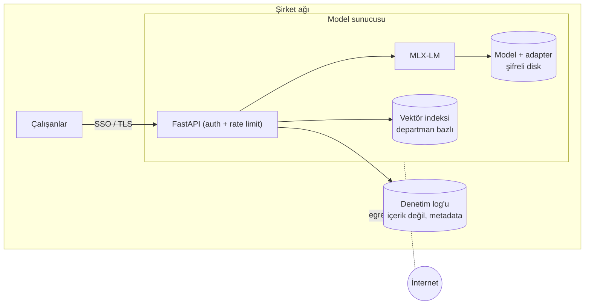

# 08 · Security and Offline Operation

[← README](../README.md)

## 1. Yerel çalıştırmanın avantajları

| Avantaj | Açıklama |
|---|---|
| Veri egemenliği | İstemler, cevaplar ve dokümanlar bu makineden çıkmaz. |
| Üçüncü taraf yok | Model sağlayıcısının loglama, saklama ve eğitim politikalarına bağımlılık yok. |
| Ağdan bağımsızlık | İnternet kesikken de çalışır. Hava boşluklu (air-gapped) ortamlara taşınabilir. |
| Denetlenebilirlik | Hangi modelin, hangi adapter'ın ve hangi kodun çalıştığı bilinir. |

## 2. Sınırlar (yerel ≠ otomatik olarak güvenli)

| Sınır | Açıklama |
|---|---|
| Uç nokta güvenliği | Makine ele geçirilirse model, veri ve adapter'lar da ele geçirilir. Disk şifrelemesi (FileVault) açık olmalıdır. |
| Kimlik doğrulama yok | API'de auth yok. `127.0.0.1` bağlaması bu yüzden kritiktir. `--host 0.0.0.0` **kullanılmamalıdır**. |
| Tarayıcı | Tarayıcı eklentileri `localhost:3000` sayfasını okuyabilir. |
| Tedarik zinciri | pip ve npm paketleri kurulum sırasında üçüncü taraf koddur. Sürümler sabitlenmiştir; hash doğrulaması henüz yoktur. |
| Model davranışı | Yerel model de hallucination üretir ve prompt injection'a açıktır (özellikle RAG ile). |
| Model lisansı | Yerel çalıştırma, lisans yükümlülüklerini ortadan kaldırmaz. |

## 3. Offline inference

**Mevcut durum [Ölçüm]:**
- `MODEL_PATH` bir **yerel klasördür**. MLX-LM klasör yolu verildiğinde Hugging Face'e bağlanmaz.
- Backend ve `mlx_lm.generate`, `HF_HUB_OFFLINE=1` ile çalıştırıldı ve testler başarılı oldu.

**İlk kurulumda internet gerektiren adımlar:**

| Adım | Ne indirir |
|---|---|
| `brew install python@3.12` | Python |
| `pip install -r requirements.txt` | Python paketleri |
| `hf download …` | Model ağırlıkları (~0.7 GB) |
| `npm install` | Frontend paketleri |

**Doğrulama prosedürü:**
1. Wi-Fi'ı kapat.
2. `HF_HUB_OFFLINE=1 uvicorn app.main:app --host 127.0.0.1 --port 3001`
3. Arayüzden soru sor. Cevap geliyorsa model yerelde çalışıyor demektir.
4. Daha güçlü kanıt (planlandı): macOS'ta `nettop` veya Little Snitch benzeri bir araçla backend sürecinin dış bağlantı açmadığını izlemek.

## 4. Harici API bağımlılıkları

| Bileşen | Dış çağrı | Durum |
|---|---|---|
| `backend/app/*` | Yok | ✅ |
| `frontend/src/*` | Yalnızca `http://localhost:3001/api`. Harici font, CDN veya analytics yok. | ✅ |
| MLX-LM `load()` | Klasör yolu verildiğinde yok | ✅ |
| `huggingface_hub` | Yalnızca indirme sırasında | `HF_HUB_OFFLINE=1` ile kapatılır |

## 5. Telemetry

Önerilen ortam değişkenleri:

```bash
export HF_HUB_OFFLINE=1            # Hub'a hiçbir istek atma
export HF_HUB_DISABLE_TELEMETRY=1  # Hub telemetry'sini kapat
export TRANSFORMERS_OFFLINE=1      # Transformers'ı çevrimdışı moda al
```

Bu değişkenleri `backend/.env` dosyasına yazmak ve uvicorn ile yüklemek bir seçenektir (planlandı). `.env` dosyası zaten `.gitignore` içindedir.

Vite geliştirme sunucusu ve React kendi başına telemetry göndermez. Bu, kullanılan sürümler için bilinen davranıştır. Kesin kanıt için ağ izleme gerekir.

## 6. Model ve adapter güvenliği

- **Format:** Yalnızca `.safetensors` kullanılır. `.bin`, `.pt` ve `.pkl` (pickle) dosyaları yüklenirken keyfi kod çalıştırabilir. Referans repodaki `Safetensors_to_bin.py` bu yönde bir dönüşüm yapar; bu projede **kullanılmamalıdır**.
- **`trust_remote_code`:** Kapalıdır (MLX-LM varsayılanı). Açılırsa model reposundaki Python kodu çalıştırılır.
- **Kaynak:** Modeller yalnızca bilinen kaynaklardan indirilir (resmî sağlayıcı veya `mlx-community`). İndirmeden sonra SHA-256 hash'i kaydedilir (planlandı).
- **Adapter = veri:** LoRA adapter'ı eğitim verisinden bilgi taşıyabilir ve ezberlenmiş içeriği üretebilir. Adapter dosyalarına, eğitim verisiyle aynı erişim kontrolü uygulanmalıdır.
- **Fuse edilmiş model:** Fuse işleminden sonra bilgi, base ağırlıklarına gömülür. Bu model de hassas veri gibi korunmalıdır.

## 7. Eğitim verisi gizliliği

- Ham veri yalnızca `data/` altında tutulur (git-ignored).
- PII maskeleme, eğitimden **önce** yapılır ([02 §11](02-dataset-preparation.md#11-hassas-şirket-verilerinin-korunması)).
- Eğitim log'ları örnek içeriği yazdırmaz. Ancak hata mesajları içerik parçası gösterebilir; log'lar da hassas kabul edilmelidir.
- Değerlendirici model (LLM-as-judge) de **yerel** olmalıdır. Harici bir API'ye gönderilen test verisi gizliliği bozar.
- Veri saklama ve silme politikası belirlenmelidir (Faz 10). KVKK kapsamındaki veriler için hukuk birimi ile birlikte karar verilmelidir.

## 8. Hugging Face erişim tokenlarının korunması

| Kural | Neden |
|---|---|
| Token'ı koda, notebook'a veya komut satırı argümanına yazma | Shell geçmişine, notebook çıktısına ve süreç listesine düşer. Referans notebook `hf auth login --token {hf_token}` kullanıyor; bu kalıptan kaçınılmalıdır. |
| `hf auth login` komutunu interaktif çalıştır | Token, `~/.cache/huggingface/token` dosyasına yazılır, repoya yazılmaz. |
| **Read-only** veya fine-grained token kullan | Yalnızca indirme gerekiyor. Write token gereksiz risktir. |
| Token sızdıysa hemen iptal et | Hugging Face ayarlarından revoke edilir. |
| Ortam değişkeni gerekiyorsa `.env` kullan | `.env` git-ignored'dır. |

Bizim kurulumumuzda kullanılan model (`mlx-community/Llama-3.2-1B-Instruct-4bit`) gated değildir ve token gerektirmedi.

## 9. Şirket verilerinin GitHub'a yüklenmemesi

Mevcut `.gitignore`:

```gitignore
# Model weights, LoRA adapters and training data never go to GitHub.
models/*
!models/.gitkeep
adapters/*
!adapters/.gitkeep
data/*
!data/.gitkeep
*.safetensors
*.gguf
*.npz

# Python
.venv/
__pycache__/
*.pyc

# Node / Vite
node_modules/
frontend/dist/

# Secrets and local settings
.env
.env.*

# macOS
.DS_Store
```

Not: Proje şu anda bir git deposu **değildir**. Depo oluşturulmadan önce bu dosyanın içeriği tekrar kontrol edilmelidir.

Ek önlemler (planlandı):
- Pre-commit hook ile secret tarama (örneğin `gitleaks`).
- Büyük dosya engeli (> 10 MB).
- `docs/experiments/` altına yalnızca **metrikler** yazılır, örnek içerik yazılmaz.

## 10. Kurumsal veri izolasyonu (Faz 10 hedefleri)



| Hedef | Açıklama |
|---|---|
| Kimlik doğrulama | SSO veya API anahtarı. Kullanıcı başına yetki. |
| Departman izolasyonu | RAG'de erişim kontrolü: kullanıcı yalnızca yetkili olduğu dokümanlardan cevap alır. Filtre retrieval aşamasında uygulanır. |
| Adapter izolasyonu | Departman başına ayrı adapter. Bir departmanın verisi başka departmanın adapter'ına karışmaz. |
| Egress engeli | Model sunucusunun internete çıkışı firewall ile kapatılır. |
| Denetim | Kim, ne zaman, hangi model ve adapter ile sorgu yaptı. İstem içeriği varsayılan olarak loglanmaz. |
| Prompt injection | RAG dokümanlarındaki talimatlar veri olarak işlenir. Sistem mesajı ile ayrılır; araç çağrısı yetkileri sınırlanır. |
