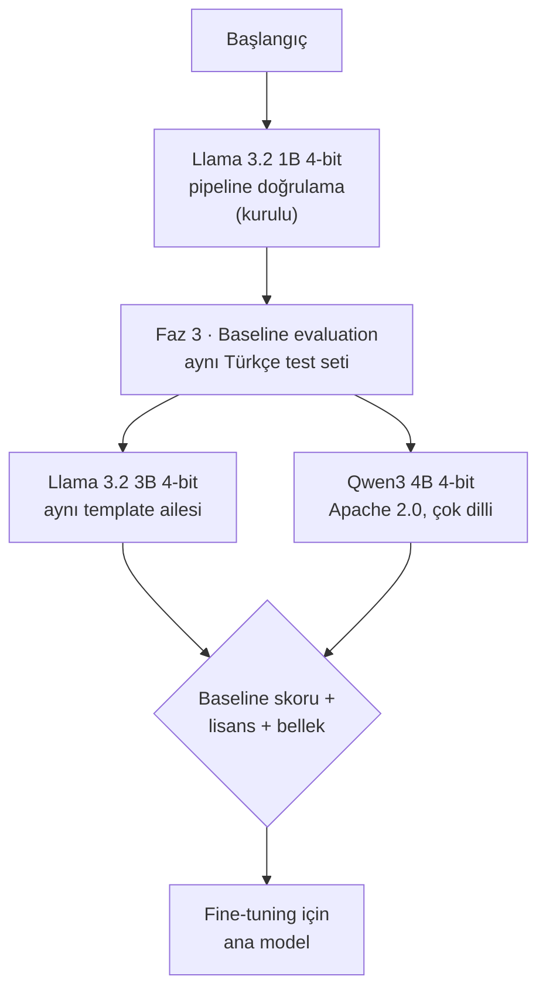

# 09 · Model Selection and Comparison

[← README](../README.md)

## Kaynaklar ve yöntem

- **Mimari:** Her modelin `config.json` dosyası (Hugging Face, mlx-community 4-bit kopyaları; mimari değerleri orijinal modelle aynıdır). 24 Kasım 2026'da indirildi ve okundu.
- **Lisans, dil, gated durumu:** Orijinal repoların Hugging Face API metadata'sı (`cardData.license`, `cardData.language`, `gated`).
- **Disk boyutu:** mlx-community 4-bit repolarındaki `.safetensors` dosyalarının toplamı.
- **Parametre sayısı:** Model kartları. Llama 3.2 1B için kendi ölçümümüz: 1 235.8 M.
- **Hız ve doğruluk:** Yalnızca kurulu 1B model için kendi ölçümümüz var. Diğer modeller için **ölçüm yoktur**. Tabloda tahmin yazılmamıştır.

Kapsam dışı: Gemma 3 4B. Çok modlu (görsel + metin) bir modeldir; config yapısı farklıdır ve kendi lisans koşulları vardır. İleride ayrıca değerlendirilebilir.

---

## 1. Mimari karşılaştırma

| Model | Parametre | Katman | Hidden | MLP ara boyut | Attn head | KV head | Head dim | Context (max_position) | Vocab | Tied emb. |
|---|---|---|---|---|---|---|---|---|---|---|
| Llama 3.2 1B Instruct | 1.24 B | 16 | 2048 | 8192 | 32 | 8 | 64 | 131 072 | 128 256 | ✅ |
| Llama 3.2 3B Instruct | 3.21 B | 28 | 3072 | 8192 | 24 | 8 | 128 | 131 072 | 128 256 | ✅ |
| Llama 3.1 8B Instruct | 8.03 B | 32 | 4096 | 14 336 | 32 | 8 | 128 | 131 072 | 128 256 | ❌ |
| Mistral 7B Instruct v0.3 | 7.25 B | 32 | 4096 | 14 336 | 32 | 8 | 128 | 32 768 | 32 768 | ❌ |
| Qwen2.5 1.5B Instruct | 1.54 B | 28 | 1536 | 8960 | 12 | 2 | 128 | 32 768 | 151 936 | ✅ |
| Qwen2.5 3B Instruct | 3.09 B | 36 | 2048 | 11 008 | 16 | 2 | 128 | 32 768 | 151 936 | ✅ |
| Qwen3 4B | 4.0 B | 36 | 2560 | 9728 | 32 | 8 | 128 | 40 960 | 151 936 | ✅ |

Notlar:
- Tüm modeller **GQA** kullanır (KV head < attention head).
- Context değeri `max_position_embeddings` alanıdır. Pratik context, bellek tarafından sınırlanır (bkz. §4).
- Qwen3 4B'de $n_{head} \times d_{head} = 4096 > d_{model} = 2560$. Attention projeksiyonları kare değildir.

## 2. Tokenizer ve dil desteği

| Model | Tokenizer | Vocab | Resmî dil listesi (HF metadata) | Türkçe |
|---|---|---|---|---|
| Llama 3.x | tiktoken tabanlı BPE | 128 256 | en, de, fr, it, pt, hi, es, th | **Resmî listede yok** |
| Mistral 7B v0.3 | SentencePiece (v3) | 32 768 | Metadata'da liste yok | Belirtilmemiş |
| Qwen2.5 | Byte-level BPE | 151 936 | Metadata: yalnızca `en` | Sağlayıcı çok dilli destek duyuruyor; metadata'da yok |
| Qwen3 | Byte-level BPE | 151 936 | Metadata'da liste yok | Sağlayıcı 100'den fazla dil duyuruyor (metadata'da değil, duyuruda) |

**Türkçe performansı:** Hiçbir model için **ölçülmedi**. Faz 3'te aynı Türkçe test seti ile karşılaştırılacak ([06 · E0](06-experimental-design.md)).

**Tokenizer verimliliği ölçümü (planlandı):** Aynı Türkçe metin için token sayısı karşılaştırılacak. Daha az token, daha hızlı üretim ve daha geniş etkin context demektir. Bu ölçüm yalnızca tokenizer dosyasını ister, modeli indirmeyi gerektirmez.

**Gözlem [Ölçüm, tek örnek]:** Kurulu 1B model `temperature 0` ile başkent sorusuna "Ankara." dedi. `temperature 0.7` ile ise "Türkiye'nin başkenti Istanbul'dir." dedi. Bu bir değerlendirme değildir; küçük modelin Türkçe bilgi güvenilirliği konusunda bir uyarıdır.

## 3. Quantization seçenekleri ve disk boyutu

| Model | 16-bit (teorik) | 8-bit (teorik, 8.5 bit) | **4-bit (gerçek dosya)** |
|---|---|---|---|
| Llama 3.2 1B | 2.47 GB | 1.31 GB | **0.70 GB** |
| Llama 3.2 3B | 6.42 GB | 3.41 GB | **1.81 GB** |
| Llama 3.1 8B | 16.06 GB | 8.53 GB | **4.52 GB** |
| Mistral 7B v0.3 | 14.50 GB | 7.70 GB | **4.08 GB** |
| Qwen2.5 1.5B | 3.08 GB | 1.64 GB | **0.87 GB** |
| Qwen2.5 3B | 6.18 GB | 3.28 GB | **1.74 GB** |
| Qwen3 4B | 8.0 GB | 4.25 GB | **2.26 GB** |

Teorik değerler $P \times \text{bit}/8$ formülüyle hesaplandı. Gerçek dosyalarda bazı katmanlar (örneğin normalizasyon) quantize edilmez, bu yüzden küçük farklar olabilir.

Seçenekler (`mlx_lm.convert -q --q-bits {4,8} --q-group-size {32,64,128}`):
- **4-bit:** En küçük boyut. Küçük modellerde kalite kaybı daha belirgin olabilir.
- **8-bit:** Kaliteye daha yakın, boyut iki katına yakın.
- **Group size:** Küçük grup daha doğru, ama scale ve bias yükü daha fazla: $4 + 32/g$ bit.

## 4. Bellek ihtiyacı (inference, teorik)

$$M_{inf} \approx M_{weights} + M_{KV} + M_{act}, \qquad M_{KV} = 2 \cdot L \cdot n_{kv} \cdot d_{head} \cdot \text{bayt} \cdot T$$

KV cache fp16 (2 bayt) varsayımıyla:

| Model | KV / token | KV @ 4 096 token | KV @ 32 768 token | 4-bit ağırlık + KV @ 4 096 |
|---|---|---|---|---|
| Llama 3.2 1B | 32 KB | 128 MB | 1.0 GB | ~0.83 GB |
| Llama 3.2 3B | 112 KB | 448 MB | 3.5 GB | ~2.26 GB |
| Llama 3.1 8B | 128 KB | 512 MB | 4.0 GB | ~5.03 GB |
| Mistral 7B v0.3 | 128 KB | 512 MB | 4.0 GB | ~4.59 GB |
| Qwen2.5 1.5B | 28 KB | 112 MB | 0.9 GB | ~0.98 GB |
| Qwen2.5 3B | 36 KB | 144 MB | 1.1 GB | ~1.88 GB |
| Qwen3 4B | 144 KB | 576 MB | 4.5 GB | ~2.84 GB |

**[Ölçüm]** Llama 3.2 1B, kısa prompt: 0.861 GB peak. Teorik ağırlık değeri (0.70 GB) ile uyumlu.

**Sınır [Ölçüm]:** `max_recommended_working_set_size = 12.71 GB`.

## 5. Fine-tuning uygunluğu (16 GB, LoRA r=8, num_layers=16)

| Model | Eğitilebilir param. (r=8, 16 katman, tüm lineer) | 4-bit ağırlık | 16 GB'ta LoRA (teorik değerlendirme) |
|---|---|---|---|
| Llama 3.2 1B | 5.64 M (**ölçüldü**) | 0.70 GB | Rahat |
| Qwen2.5 1.5B | 5.28 M | 0.87 GB | Rahat |
| Qwen2.5 3B | 6.65 M | 1.74 GB | Uygun |
| Llama 3.2 3B | 6.95 M | 1.81 GB | Uygun |
| Qwen3 4B | 7.34 M | 2.26 GB | Uygun, küçük batch ile |
| Mistral 7B v0.3 | 10.49 M | 4.08 GB | Sınırda: B=1–2, grad_checkpoint, kısa diziler |
| Llama 3.1 8B | 10.49 M | 4.52 GB | Sınırda. Büyük vocab'ın logit belleği ek yük getirir. |

1B dışındaki parametre sayıları `config.json` değerlerinden formülle hesaplandı. "Rahat / uygun / sınırda" değerlendirmesi ağırlık ve aktivasyon tahminine dayanır; **ölçülmedi**.

## 6. Inference performansı

| Model | Üretim hızı | Peak memory | Kaynak |
|---|---|---|---|
| Llama 3.2 1B 4-bit | 160.4 token/sn (CLI), 114–139 token/sn (API) | 0.86 GB | **[Ölçüm]** bu makine |
| Mistral 7B 16-bit + LoRA | 22.4–23.5 token/sn | 14.68 GB | **[Referans]** bilinmeyen donanım |
| Diğerleri | — | — | Ölçülmedi |

**Teorik beklenti:** Token üretimi bellek bant genişliği ile sınırlıdır. Bu yüzden hız, kabaca ağırlık boyutuyla ters orantılıdır. Bu bir tahmindir. Karşılaştırma `mlx_lm.benchmark` ile ölçülecek.

## 7. Lisans ve ticari kullanım

| Model | Lisans (HF metadata) | Gated | Ticari kullanım (özet; hukuki görüş değildir) |
|---|---|---|---|
| Llama 3.2 1B / 3B | `llama3.2` (Llama 3.2 Community License) | Evet (manuel onay) | İzinli. Aylık aktif kullanıcısı 700 M üzerindeki şirketler için Meta'dan ayrı lisans gerekir. Acceptable Use Policy ve "Built with Llama" ibaresi gibi yükümlülükler vardır. |
| Llama 3.1 8B | `llama3.1` | Evet | Benzer koşullar |
| Mistral 7B v0.3 | `apache-2.0` | Hayır | İzinli (Apache 2.0) |
| Qwen2.5 1.5B | `apache-2.0` | Hayır | İzinli (Apache 2.0) |
| Qwen2.5 3B | `other` (Qwen Research License) | Hayır | **Kısıtlı.** Araştırma lisansı; ticari kullanım ayrı izin gerektirir. |
| Qwen3 4B | `apache-2.0` | Hayır | İzinli (Apache 2.0) |

Not: mlx-community kopyaları orijinal lisansı devralır. Gated bir modelin gated olmayan bir kopyasını indirmek, lisans koşullarını ortadan kaldırmaz.

## 8. Öneri: MacBook Air M3, 16 GB

| Sıra | Model | Rol | Gerekçe |
|---|---|---|---|
| 1 | **Llama 3.2 1B 4-bit** | Geliştirme ve pipeline doğrulama | Kurulu, ölçülmüş (0.86 GB, ~160 tok/s), dakikalar içinde eğitilebilir. Hata ayıklamak ucuz. |
| 2 | **Llama 3.2 3B 4-bit** | Kalite için birincil aday | Aynı tokenizer ve chat template. 1B'de kurulan veri ve eğitim hattı doğrudan taşınır. 1.81 GB ağırlık, 16 GB'ta eğitim için pay bırakır. |
| 3 | **Qwen3 4B 4-bit** | Türkçe ve lisans alternatifi | Apache 2.0. Sağlayıcı geniş çok dilli destek duyuruyor. Farklı chat template ailesi olduğu için ayrı veri tokenizasyonu gerekir. |
| — | Mistral 7B, Llama 3.1 8B | İleride, ölçümle | Inference için sığar. LoRA eğitimi 16 GB'ta sınırda ve ölçülmeden önerilmez. |
| — | Qwen2.5 3B | Önerilmez (ticari kullanım için) | Lisans kısıtı. |

**Karar kuralı:** Model seçimi bu tabloya göre değil, Faz 3'teki **ölçülmüş** baseline skoruna, bellek ölçümüne ve lisans uygunluğuna göre yapılacaktır.
