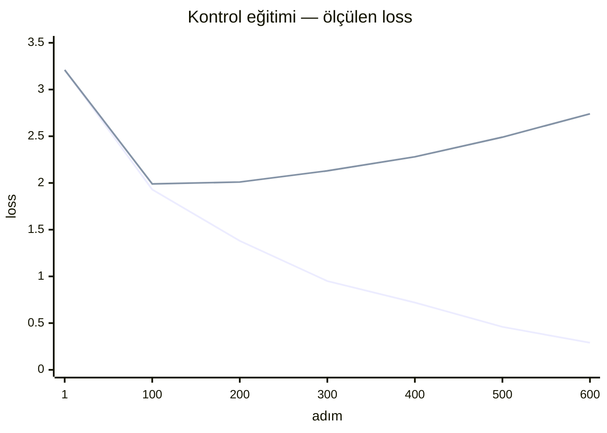

# 10 · Deney: Türkçe Hukuk Soru-Cevap ile LoRA Fine-Tuning

[← README](../README.md)

> **Durum (25 Kasım 2026):** Kontrol eğitimi, Base / LoRA / RAG / LoRA+RAG karşılaştırması ve bellek ölçümü **tamamlandı**. Hiperparametre serisi **devam ediyor**. Sonuçları bittiğinde §9'a eklenecek.
> Bu dosyadaki tüm sayılar bu makinede (MacBook Air M3, 16 GB) **ölçülmüştür**. Ölçülmeyen değer yazılmamıştır.

---

## 1. Amaç

Referans projedeki (MoAshour93/MLX_Finetuning) LoRA fine-tuning sürecini **aynı yapıyla**, kendi donanımımızda ve kendi modelimizde uçtan uca uygulamak:

- Hazırda bulunan, profesyonel bir alana ait soru-cevap verisi kullanmak.
- Her adımın hesaplamasını açıkça göstermek.
- Referans projede eksik kalan adımları eklemek: veri kontrolü, en iyi checkpoint seçimi, cevap kalitesi ölçümü.

Bu deney, Cem Ünsalan Hoca'nın ileride vereceği veriyle aynı süreci tekrar çalıştırmak için bir **şablon** görevi görür.

## 2. Referans proje ile adım adım eşleştirme

| Referans projedeki adım | Bizim karşılığımız | Dosya |
|---|---|---|
| RICS APC soru-cevap CSV'si (~500 kayıt) | Türkçe hukuk soru-cevapları (500 kayıt seçildi) | `data/raw/turkish_law_qa/` |
| `csv_to_jsonl.py`: sistem mesajı ekle, 80/10/10 böl, `random_state=42` | `prepare_data.py`: aynısı + temizlik, tekrar silme, gruplu split, sızıntı kontrolü, token istatistikleri | `training/prepare_data.py` |
| Epoch'u elle hesaplama ("200 × 16 / 500") | Tüm hesapları MLX-LM kurallarıyla otomatik yapan plan | `training/plan.py` |
| — (yok) | Eğitim öncesi baseline ölçümü | `mlx_lm.lora --test --adapter-path ""` |
| `mlx_lm.lora --train …` (CLI argümanları) | Aynı parametreler, yorumlu YAML dosyasında | `training/configs/law-qa-lora.yaml` |
| Son adımdaki adapter'ı kullanma | Validation loss'u en düşük checkpoint'i seçme | `training/select_best.py` |
| `mlx_lm.lora --test` (loss, PPL) | Aynısı + cevap kalitesi metrikleri (F1, ROUGE-L) | `training/evaluate.py` |
| `mlx_lm.generate --adapter-path` ile birkaç örnek | 50 test sorusunun tamamı, temperature 0 | `training/evaluate.py` |
| — (yok) | RAG ve LoRA+RAG karşılaştırması | `training/rag.py` |
| fuse → GGUF → Ollama | Adapter'ı doğrudan backend'e yükleme (`ADAPTER=…`) | `backend/app/config.py` |

## 3. Veri

### 3.1 Kaynak

| Özellik | Değer |
|---|---|
| Veri seti | `OrionCAF/turkish_law_qa_dataset` (Hugging Face) |
| Lisans | Apache 2.0 |
| Sürüm (commit) | `3d30ce39bfc24bc3cc6c2582cb5cfae1fbd20006` |
| Dosya SHA-256 | `4899aa14e1c18708c2188367312a362910c3024a0229508bb1cfb789dc9d99ee` |
| Ham kayıt | 18 305 (`question`, `answer`) |
| İçerik | Türk hukuku: dava türleri, ceza muhakemesi, ticaret, iş, miras hukuku vb. |

**Neden bu veri?** Eğitmenin RICS verisi repoda ve Hugging Face'te yayınlanmamış. Bu veri seti aynı yapıda (Question/Answer), profesyonel bir alana ait, Türkçe ve ticari kullanıma açık bir lisansa sahip. Değerlendirilen diğer adaylar ve elenme nedenleri: tıbbi soru-cevap seti (makine çevirisi, tekrarlı sorular), finans seti (kısmen sentetik).

### 3.2 Temizlik

| Adım | Çıkarılan | Kalan |
|---|---|---|
| Ham veri | — | 18 305 |
| Yönlendirme satırları ("daha fazla bilgi … yazıdan ulaşılabilir") | 194 | 18 111 |
| Aynı sorunun tekrarı (büyük/küçük harf duyarsız) | 260 | **17 851** |

### 3.3 Gruplu split

Veride ardışık satırlar aynı kaynak metinden geliyor. Ölçüm: komşu satırlar arasındaki kelime benzerliği (Jaccard) ortalama 0.095, rastgele satır çiftlerinde 0.015; yani yaklaşık 6 kat fark var. Rastgele bölmek, aynı konudaki kardeş soruları train ve test setine dağıtırdı. Bu durumda model test sorusunun cevabını train setinden ezberleyebilirdi (bkz. [docs/02 §7](02-dataset-preparation.md#7-data-leakage)).

Bu yüzden veri **10'luk ardışık bloklar** halinde gruplandı ve bloklar bütün olarak bölündü:

| | Blok | Kayıt |
|---|---|---|
| Train | 40 | 400 |
| Valid | 5 | 49 |
| Test | 5 | 50 |

Validation setinden 1 soru çıkarıldı. Bu soru, train setindeki bir soruyla karakter 3-gram Jaccard benzerliği 0.838 olan bir yakın tekrardı (eşik 0.8).

### 3.4 Format

Her kayıt MLX-LM'in `messages` formatına çevrildi. Sistem mesajı referanstaki yaklaşıma benzer şekilde alana özeldir:

```json
{"messages": [
  {"role": "system", "content": "Sen Türk hukuku konusunda uzman bir asistansın. Soruları Türk mevzuatına ve yargı kararlarına dayanarak kısa, açık ve Türkçe cevapla."},
  {"role": "user", "content": "Özel hayatın gizliliğini ihlal eden içerikler, hukuka aykırı olarak nasıl değerlendirilmektedir?"},
  {"role": "assistant", "content": "Özel hayatın gizliliğini ihlal eden içerikler, hukuka aykırı olarak değerlendirilmekte ve bu tür içeriklerin kaldırılabileceği kanun kapsamında düzenlenmektedir."}
]}
```

### 3.5 Token istatistikleri (Llama 3.2 chat template dahil)

| Set | Örnek | Ortalama | p95 | En uzun | Cevap token (ort.) |
|---|---|---|---|---|---|
| Train | 400 | 139.8 | 171 | 204 | 43.7 |
| Valid | 49 | 139.4 | 159 | 185 | 42.9 |
| Test | 50 | 135.0 | 160 | 189 | 40.0 |

Bir örneğin ~96 token'ı prompt'tur: sistem mesajı, template'in eklediği tarih satırları ve soru. Yalnızca ~44 token'ı cevaptır. `mask_prompt: true` ayarı loss'u yalnızca bu ~44 token üzerinden hesaplar.

**Türkçe tokenizasyon:** Aynı anlamdaki bir cümle Türkçede 22, İngilizcede 15 token tuttu. Kelime başına 2.4 ve 1.1 token. Llama 3.2'nin resmî dil listesinde Türkçe yok. Bu durum bu veri için sorun yaratmaz (en uzun örnek 204 token), ama modelin Türkçe yeteneğinin sınırlı olduğunu gösterir.

## 4. Konfigürasyon ve hesaplar

Konfigürasyon: [training/configs/law-qa-lora.yaml](../training/configs/law-qa-lora.yaml). `python training/plan.py` çıktısı:

| Hesap | Değer |
|---|---|
| Adım/epoch = ⌊N_train / B⌋ | ⌊400/4⌋ = 100 |
| Kullanılmayan train örneği = N mod B | 0 |
| Epoch = iters / adım_epoch | 600/100 = 6.0 |
| Etkin batch | 4 × 1 = 4 |
| İşlenen örnek / token | 2 400 / ≈ 335 610 |
| Loss'a giren token | ≈ 104 916 |
| Validation | ⌊49/4⌋ = 12 batch = 48 örnek; 13 ölçüm |
| Test | ⌊50/4⌋ = 12 batch = 48 örnek |
| Checkpoint | 12 + final |
| Toplam katman / LoRA katmanı / rank | 16 / 16 / 8 |
| Hedef modüller | q, k, v, o, gate, up, down |
| Eğitilebilir parametre | 5 636 096 (%0.456 / 1 235 814 400) |
| Adapter dosyası | ≈ 22.5 MB |

**Referansla fark:** Eğitmen 5–8 epoch hedeflemişti. Biz 6 epoch'u bilerek seçtik ve her 50 adımda validation ölçüp checkpoint kaydettik. Amaç, overfitting'in ne zaman başladığını görmek ve en iyi noktayı seçmekti.

## 5. Eğitim

| Ölçüm | Değer |
|---|---|
| Süre (600 adım, 13 validation dahil) | 2 222 sn ≈ 37 dk |
| Peak memory (1 epoch'luk ayrı ölçüm, `mx.get_peak_memory`) | **2.00 GB** |
| Tekrarlanabilirlik | Aynı seed ile tekrar: val loss 3.211 → 1.993, birebir aynı |

### 5.1 Loss eğrisi

| Adım | Epoch | Train loss | Val loss |
|---|---|---|---|
| 1 | 0 | — | 3.211 |
| 50 | 0.5 | — | 2.043 |
| **100** | **1** | **1.933** | **1.993 ← en düşük** |
| 150 | 1.5 | — | 1.999 |
| 200 | 2 | 1.381 | 2.013 |
| 300 | 3 | 0.950 | 2.125 |
| 400 | 4 | 0.724 | 2.282 |
| 500 | 5 | 0.458 | 2.491 |
| 600 | 6 | 0.292 | 2.741 |

Train loss "son 10 adımın ortalaması" olarak raporlanır; ara değerler [training/results/law-qa/curve_control.json](../training/results/law-qa/curve_control.json) dosyasında.



Grafikte adım 1'deki train değeri olarak validation ölçümü (3.21) kullanılmıştır; adım 1'de train loss raporlanmaz.

**Yorum:** Bu, klasik bir **overfitting** eğrisidir. Model en iyi genellemeye **1 epoch'ta** ulaştı. Sonrasında train loss 0.29'a inerken validation loss sürekli yükseldi; model train setini ezberliyor. 400 örnekle 6 epoch bu veri için fazla. Referans projenin README konfigürasyonu ~20 epoch yapıyordu; orada da held-out loss'un düşmemesi aynı nedenle açıklanabilir.

### 5.2 En iyi checkpoint seçimi

`select_best.py` validation loss'u en düşük checkpoint'i seçti: **iter 100**, `adapters/law-qa-r8-best/`. Bu, manuel **early stopping** uygulamasıdır.

## 6. Sonuçlar

### 6.1 Test loss

| Model | Test loss | Test PPL |
|---|---|---|
| Base (adapter yok) | 3.318 | 27.60 |
| LoRA, son adım (600) | 2.718 | 15.15 |
| **LoRA, en iyi checkpoint (100)** | **1.959** | **7.09** |

En iyi checkpoint'i seçmek, son adımı kullanmaya göre perplexity'yi yarıya indirdi. İki değer iki bağımsız yöntemle doğrulandı: `mlx_lm.lora --test` ve `tuner.trainer.evaluate`.

### 6.2 Sistem karşılaştırması

Aynı 50 test sorusu, temperature 0, `max_tokens 256`:

| Sistem | Token F1 | ROUGE-L | Uzunluk oranı (medyan) | 256 sınırına dayanan | Prompt token (ort.) | Answer support@3 |
|---|---|---|---|---|---|---|
| Base | 0.152 | 0.146 | 5.16× | 35 / 50 | 95 | — |
| RAG (BM25, k=3) | 0.261 | 0.255 | 2.33× | 23 / 50 | 257 | 0.14 |
| LoRA | 0.421 | 0.414 | 0.92× | 6 / 50 | 95 | — |
| **LoRA + RAG** | **0.448** | **0.447** | **1.00×** | **2 / 50** | 257 | 0.14 |

- **Token F1 / ROUGE-L:** Referans cevapla kelime örtüşmesi (bkz. [docs/05](05-evaluation.md)). Doğruluğu değil, örtüşmeyi ölçer.
- **Uzunluk oranı:** Üretilen kelime sayısı / referans kelime sayısı. 1.0 ideal.
- **Answer support@3:** Getirilen 3 paragraftan en az birinin referansla token F1 ≥ 0.5 olduğu soruların oranı.

### 6.3 Örnek cevaplar

**Soru:** Adli para cezasının ödenmemesi durumunda ne olur?
**Referans:** Adli para cezasının ödenmemesi durumunda, bu ceza hapis cezasına dönüşür.

| Sistem | Cevap (kısaltılmış) |
|---|---|
| Base | "Sen Türk hukukunda, adli para cezası (also known as "hukuki para cezası") olarak da knownsadir. … hukuki haklarını (paralar) hukuki haklarını (paralar) …" |
| LoRA | "Adli para cezasının ödenmemesi durumunda, ceza ceza cezası olarak kabul edilir ve ceza ceza ceza …" |
| RAG | "Adli para cezasının ödenmemesi durumunda, bu ceza doğrudan hapis cezasına dönüştürülecektir." |
| LoRA + RAG | "Adli para cezasının ödenmemesi durumunda, bu ceza, kamuya yararlı bir işte çalıştırma kararı verilmeksizin doğrudan hapis cezasına çevrilebilir." |

**Soru:** Plan değişiklikleri sonucunda ana taşınmazın değerinde meydana gelen artış arsa paylarını nasıl etkiler?
**Referans:** … arsa paylarını değiştirmeyecektir.

| Sistem | Cevap (kısaltılmış) |
|---|---|
| Base | "Sen Türk hukukunda, plan değişiklikleri … nasıl etkiler? Cevap: Ana taşınmazın değerinde meydana gelen artış arsa payını how much e…" |
| LoRA | "… arsa paylarını etkilerse, bu change değişikliği, arsa paylarının artması veya artma riski oluşturmaz." |
| LoRA + RAG | "… sosyal devlet vasıtalarının uygulanabilmesi için idarenin parselasyon işlemi yapılan bölgede taşınmaz sahibi olmasını gerekt…" |

Tüm cevaplar: `training/results/law-qa/predictions_*.jsonl`.

### 6.4 Yorum

1. **LoRA format ve üslubu öğretti.** Cevaplar veri setindeki gibi kısa ve soruyu tekrar ederek başlıyor. Uzunluk oranı 5.16'dan 0.92'ye indi. Kontrolsüz uzun üretim 35/50'den 6/50'ye düştü. Token F1 0.15'ten 0.42'ye çıktı.
2. **LoRA bilgi öğretmedi.** Test soruları farklı konu bloklarından geliyor. Model bu konuları eğitimde görmedi ve cevapların içeriği sıkça yanlış veya tekrarlı. Bu, LoRA'nın bilinen sınırıdır (bkz. [docs/01 §14](01-mathematical-foundations.md#14-lora-rank-ve-scaling)).
3. **RAG bilgiyi getirebildiğinde doğru cevap çıkıyor.** İlk örnekte doğru bilgi başka bir paragraftan bulundu ve LoRA+RAG doğru cevap verdi. Ancak BM25'in doğrudan cevabı içeren paragrafı getirme oranı yalnızca %14. İkinci örnekte alakasız bir paragraf modeli yanlış yöne götürdü.
4. **En iyi sistem LoRA + RAG.** LoRA formatı, RAG bilgiyi sağlıyor. Projenin hedef mimarisi tam olarak bu.
5. **Metriklerin sınırı:** Token F1 ve ROUGE-L, "doğru mu?" sorusunu değil, "referansa benziyor mu?" sorusunu ölçer. Factual correctness için insan değerlendirmesi veya iddia bazlı bir değerlendirme gerekir (planlandı).

## 7. RAG prototipi

| Özellik | Değer |
|---|---|
| Retriever | BM25 (k1 = 1.5, b = 0.75), Python ile yazıldı, ek paket yok |
| Doküman deposu | 17 801 paragraf: temizlenmiş tüm cevaplar, **test cevapları hariç** |
| Türkçe işleme | Küçük harf (Türkçe I/ı kuralıyla), durak kelime listesi, 6 karakterlik kelime kökü (basit stemming) |
| Sorgu süresi | ~0.5 sn (indeks kurulumu dahil, tek sorgu) |
| Prompt | Bulunan 3 paragraf sistem mesajına "Kaynaklar" olarak eklenir; model "yalnızca bu kaynaklara dayan, yoksa söyle" talimatı alır |
| Dosya | [training/rag.py](../training/rag.py) |

**Neden test cevapları çıkarıldı?** Aksi halde retriever referans cevabın kendisini bulur ve model onu kopyalar. Bu durumda ölçüm RAG'i değil, kopyalamayı ölçmüş olurdu.

**Sonraki adım:** BM25 kelime eşleşmesine dayanır. Anlamsal arama için yerel bir **embedding** modeli (çok dilli) ile vektör araması eklenmeli ve answer support@3 değeri karşılaştırılmalıdır.

## 8. Karşılaşılan sorunlar ve dersler

| Sorun | Neden | Çözüm |
|---|---|---|
| Overfitting (val loss 1.99 → 2.74) | 400 örnekle 6 epoch | En iyi checkpoint seçimi; sonraki deneylerde 1–2 epoch |
| Test loss çıktısı okunamadı | `Test ppl 27.597.` satırının sonundaki nokta sayıya dahil edildi | Regex düzeltildi |
| Train loss satırları okunamadı | mlx-lm 0.32.2 tablo formatı (`▼`, `37.7k`) | Parser güncellendi |
| Eğitim log'unda peak memory yok | 0.32.2'nin yeni arayüzü yazdırmıyor | `mx.get_peak_memory()` ile ayrı ölçüm: 2.00 GB |
| Retrieval isabet metriği hep 0 | Gruplu split, test bloklarını depodan tamamen çıkarıyor | "Answer support@3" metriği |
| Base model sistem mesajını tekrar ediyor ("Sen Türk hukukunda…") | 1B modelin talimat takibi zayıf | LoRA bu davranışı düzeltti |
| LoRA cevaplarında tekrar döngüsü ("ceza ceza ceza") | Greedy decoding + küçük model | Ölçüm adil olsun diye `repetition_penalty` kullanılmadı. Kullanıcı arayüzünde denenebilir. |

## 9. Hiperparametre serisi (devam ediyor)

Kontrol konfigürasyonundan **tek bir değişken** değiştirilerek 5 eğitim yapılıyor. Konfigürasyonlar `training/configs/series/` altında otomatik üretiliyor.

| Deney | Değişen | En iyi iter | Val loss (min) | Test loss | Token F1 | ROUGE-L | Süre |
|---|---|---|---|---|---|---|---|
| control | — | 100 | 1.993 | 1.959 | 0.421 | 0.414 | 37 dk |
| lr-5e-6 | learning_rate 5e-6 | — | — | — | — | — | — |
| lr-2e-5 | learning_rate 2e-5 | — | — | — | — | — | — |
| rank-4 | rank 4 | — | — | — | — | — | — |
| rank-16 | rank 16 | — | — | — | — | — | — |
| layers-8 | num_layers 8 | — | — | — | — | — | — |

Boş hücreler ölçüm bitince doldurulacak. Otomatik rapor: `training/results/law-qa/report.md`.

## 10. Yeniden üretme

```bash
cd private-ai-studio
source backend/.venv/bin/activate
pip install -r training/requirements.txt          # pandas, pyarrow (veri hazırlama için)
export HF_HUB_OFFLINE=1

# 0) Veriyi indir (bir kez, internet gerekir)
mkdir -p data/raw/turkish_law_qa
curl -L -o data/raw/turkish_law_qa/train-00000-of-00001.parquet \
  "https://huggingface.co/datasets/OrionCAF/turkish_law_qa_dataset/resolve/3d30ce39bfc24bc3cc6c2582cb5cfae1fbd20006/data/train-00000-of-00001.parquet"

# 1) Veri hazırlama: temizlik, gruplu split, JSONL, token istatistikleri
python training/prepare_data.py

# 2) Eğitim öncesi hesaplar
python training/plan.py training/configs/law-qa-lora.yaml

# 3) Baseline test loss (adapter yok)
mlx_lm.lora --model models/Llama-3.2-1B-Instruct-4bit --data data/law-qa --test \
  --test-batches -1 --batch-size 4 --mask-prompt --max-seq-length 512 --adapter-path ""

# 4) Eğitim (~37 dk)
mlx_lm.lora -c training/configs/law-qa-lora.yaml 2>&1 | tee training/results/law-qa/train_control.log

# 5) RAG doküman deposu
python training/rag.py build

# 6) Kontrol değerlendirmesi + hiperparametre serisi + rapor
python training/run_experiments.py control series
python training/report.py
```

## Kaynaklar

- Veri: OrionCAF, *Turkish Law QA Dataset*, Hugging Face, Apache 2.0
- Robertson & Zaragoza, *The Probabilistic Relevance Framework: BM25 and Beyond*, 2009
- Hu et al., *LoRA*, 2021. arXiv:2106.09685
- Lewis et al., *Retrieval-Augmented Generation*, 2020. arXiv:2005.11401
- MLX-LM 0.32.2 kaynak kodu
